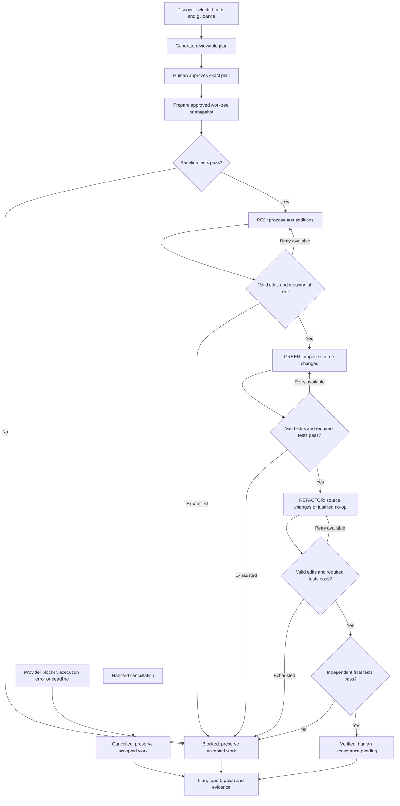

# Current architecture

For a guided introduction to Python, graph nodes and state, see [How it works](how-it-works.md).

## Layer map

| Layer | Component | Responsibility |
|---|---|---|
| Interface | `cli`, `repl` | Primary interactive shell, in-shell approval, progress and batch commands |
| Session | `session` | Bounded discovery, runtime/context scopes, worktrees, increments and reconciled continuation |
| Workflow | `workflow` | Explicit LangGraph baseline/red/green/refactor/final transitions |
| Policy | `policy` | Selected file disclosure, no symlinks, candidate validation |
| Model | `backend`, `claude_backend` | Shared proposal contract and factory; Codex and Claude Code adapters |
| Execution | `sandbox`, `process` | Independent tests; deadlines, process-group cancellation, container cleanup |
| Records | `project`, `reporting` | Version-bound approval, atomic state, snapshot branch/diff, preserved plan and final report |
| Observability | `tracing` | Optional bounded metadata recorder, local-only SDK export, deterministic TDD scores and scripted experiments |
| Evaluation | `evals`, `tests` | Scripted adversaries, real containers, optional live model |

The diagram shows one XP increment. The session controller repeats it for each approved increment using remaining budgets; `/resume` reconciles application records and enters the current phase. The REPL/discovery/session controller is the primary interface; batch runs retain their original orchestration.

Error/cancellation paths above apply across phases and are handled by the Python supervisor; they are not extra LangGraph nodes. Setup failures can occur before final artifacts are available. See the [node-level graph](how-it-works.md#5-the-execution-graph) for the exact registered nodes.

All test nodes cross into an unprivileged network-disabled container. The model crosses a separate hosted-inference boundary. The controller keeps accepted source and tests in memory; test containers receive a read-only materialized snapshot, without `.git` or approval records. Each model proposal is validated before any accepted checkout changes.

## Decisions and tradeoffs

- **Structured proposals instead of an opaque coding invocation:** preserves phase control and separates model claims from test evidence. It limits initial project size and forbids arbitrary commands.
- **Docker instead of host test execution:** protects host files and credentials with verified basic restrictions. Requires a running engine and a prepared image. Not a promise of hostile-code safety.
- **Linked worktrees for interactive Git projects:** preserve the original checkout and deliver an ordinary reviewable branch. Require a clean tracked baseline; untracked files are excluded. Non-Git and batch runs retain independent snapshots. Neither strategy is a sandbox.
- **Immutable tests after red:** prevents direct assertion weakening. Test refactoring is deliberately restricted until stronger safeguards exist.
- **LangGraph for explicit phase routing:** transparent state and retries, application records support selected-session continuation through explicit graph entry routing. No LangGraph durable checkpointer or conversation replay is configured.
- **Small sequential increments:** one approved goal can contain 1..5 behavior increments. `/resume` reconciles saved accepted files and remaining budgets. Material feedback amendments, pairing and broader context experiments remain future work. Codex and Claude are selectable per plan.

Dependency preparation occurs before a run; the approved image ID is pinned in the grant. Environment setup never installs packages in response to model output.

The initial bounded approval trades continuous human planning participation for autonomous execution within a fixed grant. Human feedback and acceptance remain valuable, but in-run material plan amendments are not implemented; continuation preserves the original agreement. This is an XP-inspired controller, not an implementation of every team-level XP practice.

Optional observability wraps the existing execution; it adds no LangGraph nodes or approval bypass. A standard-library recorder retains allowlisted metadata, and a separate process exports it to local Langfuse. SDK experiments use safe fixture IDs/results and the same REPL/controller/Docker eval paths. See [tracing](tracing.md).
