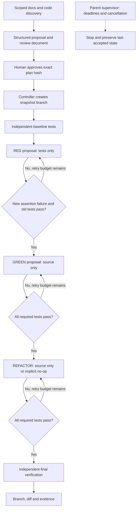

# Milestone 1 architecture

## Layer map

| Layer | Component | Responsibility |
|---|---|---|
| Interface | `cli` | Plan/review grant, run, eval commands |
| Workflow | `workflow` | Explicit LangGraph baseline/red/green/refactor/final transitions |
| Policy | `policy` | Selected file disclosure, no symlinks, candidate validation |
| Model | `backend` | Replaceable structured proposal interface; Codex adapter |
| Execution | `sandbox`, `process` | Independent tests; deadlines, process-group cancellation, container cleanup |
| Records | `project` | Version-bound approval, atomic state, snapshot branch/diff |
| Evaluation | `evals`, `tests` | Scripted adversaries, real containers, optional live model |

All test nodes cross into an unprivileged network-disabled container. The model crosses a separate hosted-inference boundary. The controller keeps accepted source and tests in memory; test containers receive a read-only materialized snapshot, without `.git` or approval records. Each model proposal is validated before any accepted checkout changes.

## Decisions and tradeoffs

- **Structured proposals instead of an opaque coding invocation:** preserves phase control and separates model claims from test evidence. It limits initial project size and forbids arbitrary commands.
- **Docker instead of host test execution:** protects host files and credentials with verified basic restrictions. Requires a running engine and a prepared image. Not a promise of hostile-code safety.
- **Snapshot repository instead of a linked worktree:** avoids copied history, hooks and live project metadata. The delivered branch is in its own repository; integrate the patch manually after review.
- **Immutable tests after red:** prevents direct assertion weakening. Test refactoring is deliberately restricted until stronger safeguards exist.
- **LangGraph for explicit phase routing:** transparent state and retries, but no durable graph resume yet. Atomic JSON records preserve recoverable work.
- **One behavior increment:** enough for a usable end-to-end prototype. Multi-increment selection, feedback continuation, alternative adapters and pair/context experiments are future work.

Dependency preparation occurs before a run; the approved image ID is pinned in the grant. Environment setup never installs packages in response to model output.
