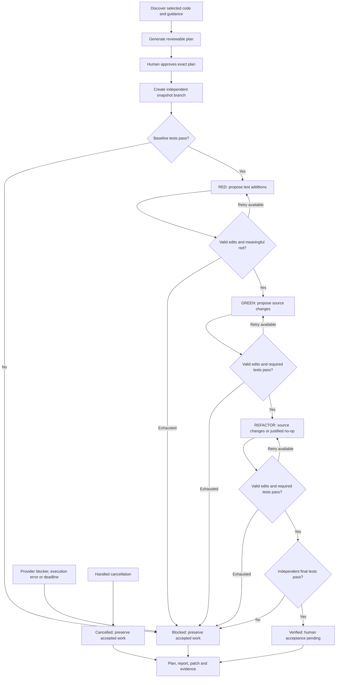

This document covers the retained explicit-file batch API. The primary interactive interface is documented in the [README](../README.md). Batch runs use independent snapshots, not the REPL session/worktree controller.

# Batch interface reference

XP Coding Agent is a local Python CLI that makes a small, approved change to a Python project through **red → green → refactor**. It uses a model to propose code, LangGraph to control the workflow, and Docker to execute tests independently of the model.

You select the task and files, review a generated plan once, and authorize it. The agent then writes a failing test, implements the behavior, considers refactoring, and verifies the result without asking for routine approval between steps. It delivers a separate Git branch, a patch, and test evidence. Your original project is not edited.

This version supports one focused behavior change per run in a trusted Python/pytest project. Provider, model and authentication are configurable. Codex CLI and Claude Code adapters implement the same proposal interface; the XP workflow is independent of the selected provider.

## Contents

- [Install and configure](#install-and-configure)
- [Use the agent on your project](#use-the-agent-on-your-project)
- [Understand the execution workflow](#understand-the-execution-workflow)
- [Implementation](#implementation)
- [Develop and evaluate the agent](#develop-and-evaluate-the-agent)
- [Troubleshooting](#troubleshooting)
- [Current boundaries](#current-boundaries)

## Install and configure

### Requirements

- Python 3.11 or newer, Git, and [uv](https://docs.astral.sh/uv/).
- A running Docker engine, such as Docker Desktop or Colima.
- Codex CLI or Claude Code on your `PATH`, depending on the selected provider. Claude adapter flags were checked against Claude Code 2.1.150.
- macOS or Linux. The implementation uses POSIX process groups and filesystem APIs; Windows is not supported directly.

From a checkout of this repository:

```sh
uv sync --frozen
docker build -f Dockerfile.tests -t xp-agent-tests:0.1 .
uv run xp-agent --help
```

`uv sync` installs the agent and its Python dependencies into this checkout's `.venv`, using `uv.lock`. `uv run` uses that environment automatically; you do not need to activate it. The Docker image is a separate environment for executing project tests, containing Python 3.13 and pytest 8.3.5. Your host virtual environment is not copied into the test container.

Run the commands below from the agent's repository directory, supplying the path to the project you want it to change.

### Provider, model and authentication

Choose these on `plan` (or `eval --live`). `run` reuses the choices in the approved plan:

| Option | Choices and defaults |
|---|---|
| `--provider` | `codex` (default) or `claude` |
| `--model` | Provider model name; defaults to `gpt-6-luna` for Codex, `haiku` for Claude; `sonnet` also selectable |
| `--auth` | `cli` (default): provider's saved credentials; `api-key`: explicit key environment variable; `oauth-token`: Claude token environment variable |

For saved login:

```sh
# Codex: choose your authorized ChatGPT account/workspace
codex login
codex login status

# Claude: choose your authorized subscription or enterprise account
claude auth login
claude auth status
# If your organization requires the explicit SSO flow:
claude auth login --sso
```

For keys/tokens, the agent reads only the variable corresponding to the selected mode:

| Provider / auth | Credential source |
|---|---|
| `codex / cli` | Codex saved login, optionally selected by `CODEX_HOME` |
| `codex / api-key` | `CODEX_API_KEY` |
| `claude / cli` | Claude Code saved login, optionally selected by `CLAUDE_CONFIG_DIR` |
| `claude / api-key` | `ANTHROPIC_API_KEY` |
| `claude / oauth-token` | `CLAUDE_CODE_OAUTH_TOKEN` (obtain through `claude setup-token`) |

Set secrets locally through your secret manager or a hidden terminal prompt; never put them in the plan, task, Git repository or chat. For example, in bash/zsh:

```sh
read -s ANTHROPIC_API_KEY
export ANTHROPIC_API_KEY
# Now run a plan with --provider claude --auth api-key
# Remove it from this shell when finished:
unset ANTHROPIC_API_KEY
```

`--auth cli` deliberately excludes key/token environment overrides. It uses whatever credential the provider CLI saved, which can itself be API-backed. There is no automatic `.env` loading, `--api-key VALUE` flag or silent provider fallback. Credential overrides are forwarded only to the selected model adapter; test containers do not receive them. Saved accounts and enterprise policies are managed by the provider CLI, not stored or verified in our plan.

See [Provider configuration and switching](providers.md) for complete Sonnet/Haiku commands, token setup, usage-limit recovery, enterprise limitations and adapter details. Authentication guidance is based on [OpenAI authentication](https://learn.chatgpt.com/docs/auth) and [Claude Code authentication](https://code.claude.com/docs/en/authentication).

**Local execution is different from local inference:** selected code, guidance, tasks and feedback are sent to the chosen hosted provider. An enterprise login alone does not certify this agent for company use.

## Use the agent on your project

### 1. Choose a small task and its scope

Start with an existing Python behavior, a passing baseline test, and a precise expected change. For example, suppose your project contains `text_utils.py`, `tests/test_text_utils.py`, and a README documenting its public functions.

Select the files needed both to understand the change and to execute its tests:

- `--source`: existing Python files the agent may modify during implementation/refactoring.
- `--tests`: Python test files the agent may extend during red. A new test file is allowed, but the selected snapshot must already have at least one passing baseline test.
- `--read`: additional context or runtime dependencies, such as architecture notes, package initializers, fixtures, or `conftest.py`. These files cannot be edited.

Paths in these lists are relative to the target project's root. Only selected files and discovered guidance are copied; imports from omitted modules will fail. Applicable `README.md`, `AGENTS.md`, and `CONTRIBUTING.md` files are discovered along the selected paths' ancestors within that root. Other documents must be selected explicitly; discovery does not crawl every linked document.

### 2. Generate and review the plan

```sh
uv run xp-agent plan /absolute/path/to/your-project \
  --task 'Make normalize_whitespace collapse whitespace runs to one space and strip surrounding whitespace; empty input stays empty.' \
  --source text_utils.py \
  --tests tests/test_text_utils.py \
  --read docs/conventions.md \
  --model gpt-6-luna \
  --budget 600 --attempts 2 \
  --output .xp-runs/whitespace-plan.json
```

Replace the example paths with files that exist in your project; omit `--read` if unnecessary. Planning reads the selected context and calls the model, but does not execute project code. It also requires the prepared Docker image to exist so its exact image ID can be included in the plan.

Review `.xp-runs/whitespace-plan.md`. It includes:

- Task, acceptance criteria, discovered files and allowed edit paths.
- Rationale, tradeoffs, a layer map and runtime diagram.
- The red/green/refactor increments and verification approach.
- Provider, model, authentication mode, image ID, limits, and an approval ID.

The JSON file holds the exact plan and source snapshot. The approval ID is a hash of that content. If the plan is wrong, clarify the task and generate a new plan with a new output filename. The CLI refuses to overwrite an existing plan.

### 3. Approve and execute

```sh
uv run xp-agent run .xp-runs/whitespace-plan.json \
  --approve FULL_APPROVAL_ID_FROM_THE_REVIEWED_PLAN \
  --output .xp-runs/whitespace-run
```

Use the full ID printed by `plan`, not the literal placeholder. Before execution, the agent verifies the plan hash and re-reads the selected source files. Changes since discovery invalidate approval and require a fresh plan.

Execution continues through the approved XP phases automatically. It retries phase-policy violations or failed test gates within the phase limit. Malformed provider responses and transport/authentication errors stop the run. It stops with evidence when there is an unresolved ambiguity, exhausted limit, unavailable prerequisite, or other condition it cannot safely resolve. Progress appears on stderr; long-running workers emit status messages. Ctrl-C requests cancellation and preserves the last accepted state.

The output directory must be new. There is no automatic resume command; retain the existing directory for review and use a new plan/run for another attempt.

### 4. Review and integrate the result

| Output | Contents |
|---|---|
| `workspace/` | Selected files on an `xp/...` branch in a separate snapshot Git repository |
| `changes.patch` | Changes against that snapshot's baseline |
| `state.json` | Status, last accepted files, attempts, test reports, code hashes, and phase rationale |
| `approved-plan.json`, `plan.md` | Exact grant and preserved human-readable initial plan |
| `events.jsonl` | Phase/status transitions and evidence counts |
| `result.md` | Final report: accepted work, test gates, rejected attempts, acceptance still pending and source divergence |
| `divergence.json` | Selected original paths that changed, or could not safely be compared at completion |

The snapshot repository has its own baseline commit and no original project history, remotes or hooks. It is **not** a linked Git worktree or a branch inside your existing repository. A successful run commits the verified change inside the snapshot repository. The agent does not push, merge, deploy, or apply the patch to your project.

Read `plan.md` and `result.md` together: the first preserves the agreement and the second records the outcome. The report is generated from controller records without another model call. It distinguishes rejected attempts from accepted changes and records no-change refactoring rationales. It does not claim that prose acceptance criteria were independently tested.

The report compares selected original paths at completion. External changes are reported without invalidating tests run against the snapshot. Unknown comparisons are explicit; unselected files are not checked. Plan amendments and additional approvals during a run are not supported: changed scope requires a fresh plan/run. Supporting tests and source refactoring within scope are normal XP work. Handled workflow blocks/cancellation produce a report; abrupt termination, setup failure or artifact-writing failure can leave incomplete artifacts.

A `verified` outcome means the automated checks passed; inspect the behavior and diff before accepting it. A blocked run may retain accepted red tests or a green implementation even though the whole task is unfinished. Failed candidates are not promoted to the workspace.

To integrate a reviewed patch, use your normal branch workflow in the original project. For example:

```sh
cd /absolute/path/to/your-project
git switch -c agent/normalize-whitespace
git apply --check /absolute/path/to/xp-coding-agent/.xp-runs/whitespace-run/changes.patch
git apply /absolute/path/to/xp-coding-agent/.xp-runs/whitespace-run/changes.patch
```

Then run your project's normal checks and review before committing. If the patch no longer applies cleanly, resolve the divergence rather than overwriting intervening work.

### Configuration reference

| Setting | Current behavior |
|---|---|
| `plan/eval --provider` | `codex` (default) or `claude` |
| `plan/eval --model` | Provider model/alias; defaults: Codex `gpt-6-luna`, Claude `haiku` |
| `plan/eval --auth` | `cli` (default), `api-key`, or Claude-only `oauth-token` |
| Authentication | Provider-managed saved login or explicitly selected environment credential; see above |
| `plan --image` | Prepared Python/pytest image; default `xp-agent-tests:0.1`; resolved to an image ID in the plan |
| `plan --budget` | Execution workflow budget in seconds; default 600, range 1–3600 |
| `plan --attempts` | Total attempts per coding phase, including the first; default 2, range 1–5 |
| `plan --output` | Plan JSON path; default `.xp-runs/plan.json`; Markdown uses the same stem |
| `run --output` | Required new directory for workspace and records |
| `eval --output` | JSON eval report; default `eval-results/latest.json` |

The adapter also caps each model invocation at 180 seconds and each test invocation at 60 seconds, subject to the remaining workflow budget. Cleanup has its own bounded allowance. These are time/attempt limits, not an exact monetary-spend cap. Codex reasoning effort is fixed to `low`; Claude uses its model default.

If your tests need extra packages, prepare a trusted Python/pytest image containing them and select it with `--image`. The container must support the runner's `python` entry point and pytest. Installing packages into the host `.venv` does not make them available to project tests. The agent never installs packages in response to model output.

## Understand the execution workflow



Provider blockers, errors and cancellation can arise at any phase; those paths are condensed above. Approval or setup failure can stop before a run report exists. There is no edge back to human approval inside a running graph.

The controller, not the model, determines whether a phase passed:

| Phase | Allowed changes | Gate |
|---|---|---|
| Baseline | None | At least one test passes; no failures, errors or skipped tests |
| Red | Append new undecorated, top-level assertion-based test functions | Existing test/setup AST statements preserved; new assertion failure; baseline tests still pass; no errors or skips |
| Green | Declared source files only | Target and baseline test identities remain present and all pass |
| Refactor | Declared source files only, or no changes with a rationale | Accepted tests remain immutable and pass |
| Final | None | Required tests pass again on the accepted final snapshot |

Syntax errors, missing imports and setup exceptions are not valid red evidence. Test weakening is not an acceptable way to reach green. Red candidates with malformed Python are rejected before execution. Refactoring is mandatory as a consideration, but unnecessary edits are not: a justified no-change decision is recorded.

This implements small increments, test-first development, simple design, refactoring, project conventions and fast feedback. It uses a single coding partner. Structural and execution checks support confidence, but cannot prove that generated tests fully capture your business intent.

## Implementation

For a programmer new to Python or LangGraph, read **[How the XP coding agent works](how-it-works.md)**. It follows the CLI entry point through planning, graph execution and reporting, explains every node and state field, and shows where to make changes.

The main layers are the CLI (`cli.py`), snapshot/approval operations (`project.py`), LangGraph phase gates (`workflow.py`), edit policy (`policy.py`), shared proposal contract/Codex adapter (`backend.py`) and Claude adapter (`claude_backend.py`), isolated tests (`sandbox.py`), subprocess supervision (`process.py`), and deterministic reports (`reporting.py`). Planning and approval happen before the graph; report rendering happens afterward. The graph is sequential and uses one model partner.

Local JSON snapshots preserve accepted work and evidence, but are not resumable LangGraph checkpoints. Each proposal uses a fresh model invocation. Both adapters implement `ProposalBackend.propose(phase, context, timeout)`. A factory selects the adapter outside the graph; changing providers uses `--provider`, not just a different model name.

Selected source is sent to the hosted model and stored in local plan/run records. Known secret patterns, sensitive paths, binary/oversized files and symlink traversal are rejected, but scanning is incomplete. Tracing is disabled. `.xp-runs/`, `eval-results/`, `.venv/` and credential files are ignored by Git; keep records private and apply equivalent protection if you choose other output locations.

## Develop and evaluate the agent

Start with [AGENTS.md](../AGENTS.md) for the contribution contract and continuation reading order. It links the public milestone handoff without mixing future capabilities into these usage instructions.

### Development setup and dependency changes

```sh
uv sync --frozen
docker build -f Dockerfile.tests -t xp-agent-tests:0.1 .
uv run xp-agent --help
```

The install is editable: changes to `xp_agent/` are used by `uv run xp-agent`. Runtime dependencies live in `pyproject.toml`; test tooling is in its `dev` dependency group. To intentionally change dependencies:

```sh
uv add PACKAGE_NAME
uv add --dev DEV_PACKAGE_NAME
uv sync --frozen
```

Review both `pyproject.toml` and `uv.lock`. After manually editing dependency declarations, use `uv lock` before syncing. Rebuild the test image when `Dockerfile.tests` changes. The Docker image and host Python dependencies serve different purposes and must be maintained separately.

To build distribution artifacts:

```sh
uv build
```

Artifacts are written to ignored `dist/`. Run from a repository checkout for the documented Dockerfile, fixtures and contributor workflow.

### Tests and eval commands

| Command | What it checks | Needs Docker? | Uses a hosted model? |
|---|---|---|---|
| `uv run pytest` | Policy, workflow routing, records, adapter contract, process supervision and CLI; integration checks skipped | No | No |
| `XP_DOCKER_TESTS=1 uv run pytest` | Full suite, including real isolation checks and scripted evals | Yes | No |
| `uv run xp-agent eval --output eval-results/scripted.json` | Seven adversarial scenarios with real pytest execution and a JSON report | Yes | No |
| `uv run xp-agent eval --live --provider codex --output eval-results/codex.json` | Scripted suite plus a live Codex XP cycle | Yes | Yes |
| `uv run xp-agent eval --live --provider claude --model haiku --auth cli --output eval-results/claude.json` | Scripted suite plus a live Claude XP cycle; select your auth mode | Yes | Yes |

The scripted cases cover success, premature green, invalid red, path escape, test weakening, ambiguity, and refactoring regression. Adversarial cases pass the eval when the workflow blocks the invalid progression. A separate acceptance test, withheld from the model, checks additional inputs after successful execution.

Reports include expected/actual status, phase sequences, elapsed time, reasons and an overall pass flag. Live runs consume the configured account's allowance and may vary. The small fixture suite is a smoke/regression check, not a broad coding-quality benchmark.

The GitHub Actions workflow installs locked dependencies, builds the image, and runs the full suite with `XP_DOCKER_TESTS=1`. CI does not need or receive model credentials and does not run the live eval.

### Making a change to the agent

1. Add a behavior-focused failing test for the controller, policy, backend or runner being changed. Confirm that it fails for the missing behavior rather than broken test setup.
2. Implement the smallest passing change, then refactor while keeping tests green.
3. Add an eval scenario when the change affects an autonomy, quality or execution boundary. Prefer a test that attempts to violate the boundary over one that repeats the implementation.
4. Run the affected tests, then the full suite for execution/workflow changes. Run a live eval when model prompts or backend behavior change and you have authorized access.
5. Update the relevant README instructions and review staged files for source-bearing logs, credentials or local artifacts before committing.

The agent can propose source changes, but its supported edit scope is narrower than general development. Repository-wide documentation, infrastructure, dependency and adapter work should use the normal contributor workflow rather than bypassing the agent's restrictions.

## Troubleshooting

| Symptom | Action |
|---|---|
| Test image unavailable | Start Docker and run the documented image build; confirm the selected image exists locally |
| Provider invocation fails | Check provider login, selected auth mode, quota, model access and CLI compatibility; raw provider errors are withheld to avoid credential leakage |
| Baseline fails or has no tests | Include the required modules/fixtures and at least one passing test; use an image with the needed dependencies |
| Approval mismatch or source changed | Generate and review a fresh plan; do not reuse a stale approval ID |
| Red is rejected | Check that tests are appended without modifying existing setup, fail by assertion, and do not skip/xfail or introduce collection errors |
| Output already exists | Choose a new plan/run output path; preserve the previous work |
| Run is blocked | Inspect `result.md` and `state.json`; clarify the task or fix the prerequisite before creating a new plan |
| Container cleanup fails | Inspect owned `xp-test-*` containers; preserve run evidence while resolving the cleanup problem |

Successful commands return exit code 0. Blocked runs and failed evals return 2. Interruptions before the workflow handles cancellation can return 130; handled cancellation is recorded in state and returns 2.

## Current boundaries

- One focused behavior increment per run; no automatic continuation across multiple stories or crash resume.
- Python/pytest execution with a prepared image. No arbitrary shell commands, automatic dependency installation, external service provisioning or browser testing.
- Existing source files only; explicitly permitted test files may be added. Non-code files are read-only context.
- New red tests must fit the supported top-level pytest function form. Tests remain immutable after red, including during refactoring.
- No automatic integration into the original project, remote publication, merge or deployment.
- Codex and Claude Code adapters only. No direct SDK adapters, arbitrary endpoints, Bedrock/Vertex/gateway configuration or automatic provider fallback. Switching requires a new approved plan; it cannot resume a blocked phase.
- Use trusted, non-sensitive projects. Structural checks cannot prove semantic correctness. Project code and pytest share a container process, so malicious code can manipulate test reporting; container restrictions are not a guarantee against arbitrary hostile repositories.

## Optional local tracing

`plan`, `run` and `eval` accept `--trace` / `--no-trace`, off by default in batch mode. Install the optional tracing dependency and configure the separate local Langfuse project first; see [local tracing](tracing.md). These flags never change the approved model or XP gates. Batch planning and execution traces are independent; REPL sessions provide shared trace-session identities.

`uv run --extra tracing xp-agent eval --experiment` runs the scripted fixtures through Langfuse's SDK experiment API. It requires a working local service and keys, refuses `--live` and `--no-trace`, and returns 2 for a failed/incomplete suite or export requirement. Ordinary evals remain usable without Langfuse. Future pairing is represented only by synthetic protocol fixtures.
