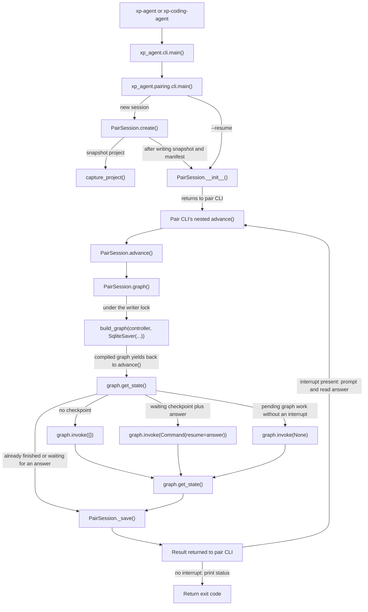
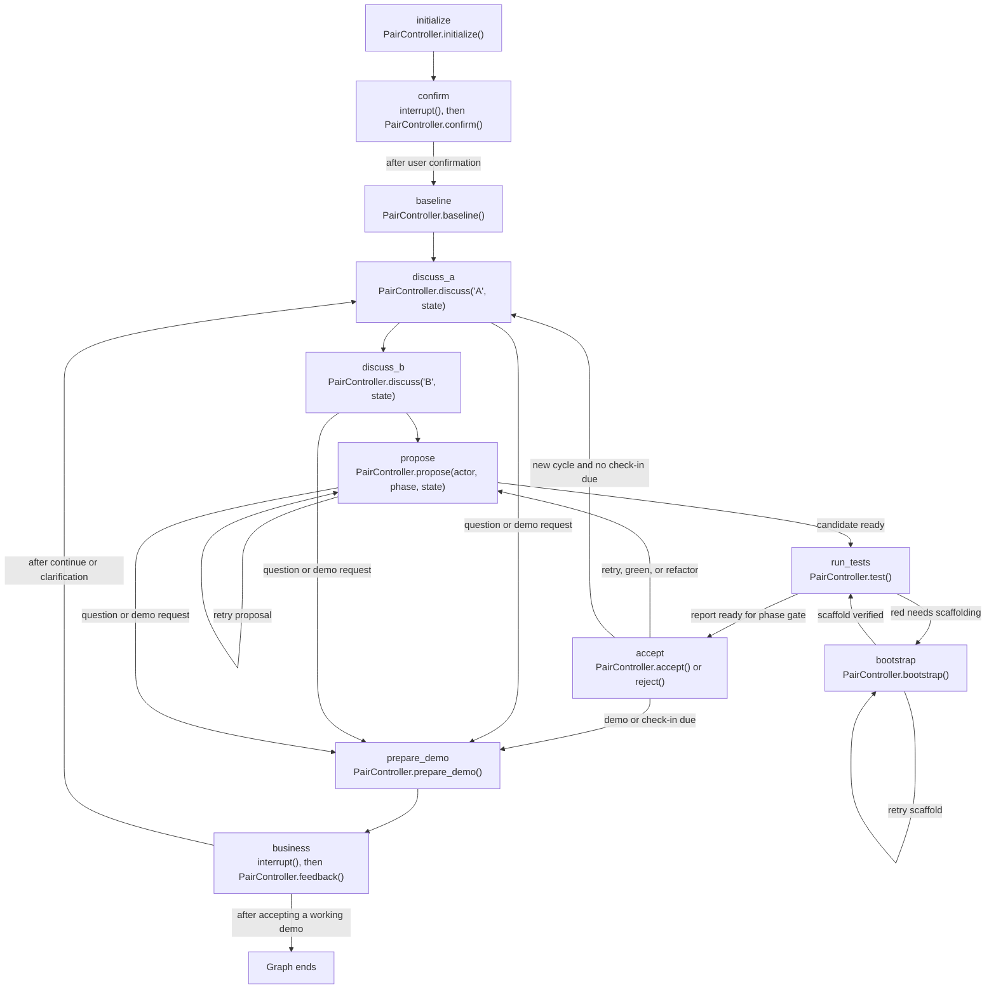

# Read the agent from the entry point

1. [cli.py](../xp_agent/cli.py) dispatches to the [pair CLI](../xp_agent/pairing/cli.py). The pair CLI creates or opens a session and turns graph interrupts into terminal prompts.
2. [session.py](../xp_agent/pairing/session.py) captures the safe content of the target project, creates a private Git snapshot, and opens a SQLite checkpointer under a writer lock. Each advance reads the current graph state and either reports a pending prompt or resumes the graph with the supplied answer.
3. [graph.py](../xp_agent/pairing/graph.py) controls the sequence. It confirms the outcome, checks the baseline, calls both partners to discuss the next behavior, and alternates test author and implementer across cycles. The node names and saved state fields are the keys used in checkpoints.
4. [controller.py](../xp_agent/pairing/controller.py) implements each action. It gives the proposed files to the [Docker runner](../xp_agent/sandbox.py) and changes the accepted snapshot only after the graph says the test gate passed. Greenfield bootstrap can add scaffolding so the test can import and call the new API. The scaffold must leave a real assertion failure.
5. [partners.py](../xp_agent/pairing/partners.py) builds a structured request from the confirmed outcome, current files, assigned phase, prior messages, and execution feedback. The [provider adapters](../xp_agent/providers/) handle transport, auth, and bounded execution. The graph controls all actions after a response.

Demos and business questions use the same graph interrupt mechanism as outcome confirmation. The session writes a patch and commits accepted output in the private snapshot repository after the user accepts a working demo. [Runtime guide](pair-runtime.md)

## Method call chain for an interactive run

Follow this when running `xp-agent pair <project>` or either executable with the default pair workflow. Start at [the console script definitions](../pyproject.toml#L18). `python -m xp_agent` reaches the same entry point through [`__main__.py`](../xp_agent/__main__.py#L1).

### CLI, session, and checkpoint

| Start here | Follow these calls |
| --- | --- |
| [`xp_agent.cli.main()`](../xp_agent/cli.py#L28) | Dispatches to [`pairing.cli.main()`](../xp_agent/pairing/cli.py#L11). Its [nested `advance()`](../xp_agent/pairing/cli.py#L53) wraps each session advance in `tracing.operation()`. |
| [`PairSession.create()`](../xp_agent/pairing/session.py#L48) | Calls [`create_backend()`](../xp_agent/providers/__init__.py#L6) to resolve the provider and model, then [`capture_project()`](../xp_agent/pairing/session.py#L18) to inventory and read eligible files. After writing the snapshot and manifest it calls [`PairSession.__init__()`](../xp_agent/pairing/session.py#L38), which creates two `Partner` instances and a `DockerRunner`. |
| [`PairSession.advance()`](../xp_agent/pairing/session.py#L110) | Enters [`PairSession.graph()`](../xp_agent/pairing/session.py#L94), which constructs a `PairController` and compiles [`build_graph()`](../xp_agent/pairing/graph.py#L33) with SQLite checkpointing. |
| [`PairSession._save()`](../xp_agent/pairing/session.py#L137) | Calls [`grade_contract()`](../xp_agent/evaluation/pair/contracts.py#L83) on the saved transition evidence. On acceptance it reconciles the workspace, writes the patch, and commits the staged changes in the snapshot repository. |

### Inside `graph.invoke()`

Arrows here show LangGraph routing. Each box names the registered node and the controller method it calls. The table links to the node functions registered in [`build_graph()`](../xp_agent/pairing/graph.py#L123) and follows their calls into the provider and runner.

`confirm()` and `business()` call `interrupt()`. The graph returns control to the CLI at those calls. The next CLI answer reaches the waiting node through `Command(resume=answer)`. Rejection at confirmation and blocked phases also have routes to the end of the graph.

| Graph node | Python call chain |
| --- | --- |
| `initialize`, `confirm` | [`initialize()`](../xp_agent/pairing/graph.py#L41) → [`PairController.initialize()`](../xp_agent/pairing/controller.py#L55). Once [`confirm()`](../xp_agent/pairing/graph.py#L44) receives confirmation, it calls [`PairController.confirm()`](../xp_agent/pairing/controller.py#L145). |
| `baseline` | [`baseline()`](../xp_agent/pairing/graph.py#L62) → [`PairController.baseline()`](../xp_agent/pairing/controller.py#L152) → `_run()` if the snapshot has existing tests. |
| `discuss_a`, `discuss_b` | [`discussion_a()` or `discussion_b()`](../xp_agent/pairing/graph.py#L65) → [`PairController.discuss()`](../xp_agent/pairing/controller.py#L166) → `_call()` for the named partner. |
| `propose` | [`propose()`](../xp_agent/pairing/graph.py#L71) selects the actor for the cycle and phase, then calls [`PairController.propose()`](../xp_agent/pairing/controller.py#L175) → `_call()`. The controller calls [`validate_edits()`](../xp_agent/policy.py#L68) for candidate edits. |
| `run_tests`, `bootstrap` | [`test()`](../xp_agent/pairing/graph.py#L77) → [`PairController.test()`](../xp_agent/pairing/controller.py#L216) → `_run()`. If red needs scaffolding, [`bootstrap()`](../xp_agent/pairing/graph.py#L80) → [`PairController.bootstrap()`](../xp_agent/pairing/controller.py#L230) → `_call()` for the implementer and `_run()` for the scaffold and pending test. |
| `accept` | [`accept()`](../xp_agent/pairing/graph.py#L83) checks the report, then calls [`PairController.accept()`](../xp_agent/pairing/controller.py#L315) → [`reconcile_workspace()`](../xp_agent/workspace.py#L89), or calls [`PairController.reject()`](../xp_agent/pairing/controller.py#L357) when the phase gate fails. [`after_acceptance()`](../xp_agent/pairing/graph.py#L162) chooses the next node. |
| `prepare_demo` | [`prepare_demo()`](../xp_agent/pairing/graph.py#L116) → [`PairController.prepare_demo()`](../xp_agent/pairing/controller.py#L373). For a working demo the controller calls `_call()` for A, [`render_demo_tests()`](../xp_agent/pairing/demos.py#L14), `_run()`, then [`demo_observations()`](../xp_agent/pairing/demos.py#L34). For a question or progress update it prepares the prompt directly. |
| `business` | [`business()`](../xp_agent/pairing/graph.py#L119) → `interrupt()` → [`PairController.feedback()`](../xp_agent/pairing/controller.py#L456) after a reply. The session saves or delivers the result when `graph.invoke()` returns. |

Two methods lead from the controller into subprocesses:

- **Model request** goes through [`PairController._call()`](../xp_agent/pairing/controller.py#L102) → [`Partner.reply()`](../xp_agent/pairing/partners.py#L132) → [`CodexBackend.request()`](../xp_agent/providers/codex.py#L37) or [`ClaudeBackend.request()`](../xp_agent/providers/claude.py#L43) → [`process.run()`](../xp_agent/process.py#L21). The structured response comes back through [`parse_reply()`](../xp_agent/pairing/partners.py#L91).
- **Test run** goes through [`PairController._run()`](../xp_agent/pairing/controller.py#L134) → [`DockerRunner.test()`](../xp_agent/sandbox.py#L47) → [`process.run()`](../xp_agent/process.py#L21) → `docker run`. The container's [pytest harness](../xp_agent/sandbox.py#L9) emits the report the runner returns to the controller.

## What passes between components

| Data | Where to look |
| --- | --- |
| Accepted files, current phase, cycle number, pending proposal, required tests, and remaining budget | `PairState` in [graph.py](../xp_agent/pairing/graph.py). The controller reads these values at each step and returns updates for LangGraph to checkpoint. |
| Model action, explanation, file edits, and demo examples | `SCHEMA` and `parse_reply()` in [partners.py](../xp_agent/pairing/partners.py). Actions are `comment`, `question`, `edit`, and `demo`. Edits carry complete file contents. |
| CLI JSON response | `request(prompt, schema, timeout)` on either [CodexBackend](../xp_agent/providers/codex.py) or [ClaudeBackend](../xp_agent/providers/claude.py). Both satisfy the same interface for `Partner`. |
| Test outcome | [DockerRunner](../xp_agent/sandbox.py) reports pytest's exit code and the identities of passing, assertion-failing, errored, and skipped tests. The graph checks these before the controller accepts a candidate. |
| Demo output | [demos.py](../xp_agent/pairing/demos.py) turns examples into temporary tests and reads their observed results. |
| Checkpoint versus evidence | The SQLite database is used to resume a session. The JSON evidence is used for offline grading of accepted transitions. [Session artifacts](pair-runtime.md#review-the-result-or-resume) |

## Follow a test or evaluation

- [Pair controller tests](../tests/pairing/test_pair_operations.py) substitute partner and runner dependencies, then verify interruption and edit boundaries.
- [Pair integration tests](../tests/pairing/test_pair_money_runtime.py) drive production sessions with scripted partners and real Docker. They cover bootstrap retries, role rotation, independent acceptance, and reopening a waiting session.
- [Evaluation tests](../tests/evaluation/) feed the graders malformed evidence and use known correct and incorrect Money implementations.
- [Tracing tests](../tests/tracing/) verify allowlisting, parent-child timing, bounded recordings, and exporter behavior with mock HTTP and in-memory spans.

The [evaluation runner](../xp_agent/evaluation/pair/runtime.py) starts the same pair session used by the terminal. It applies the [evidence grader](../xp_agent/evaluation/pair/contracts.py), observes production routing through the [graph probe](../xp_agent/evaluation/pair/graph_probe.py), and uses an [independent Docker oracle](../xp_agent/evaluation/pair/money.py) for candidate correctness. [Evaluation commands](pair-evaluations.md)
