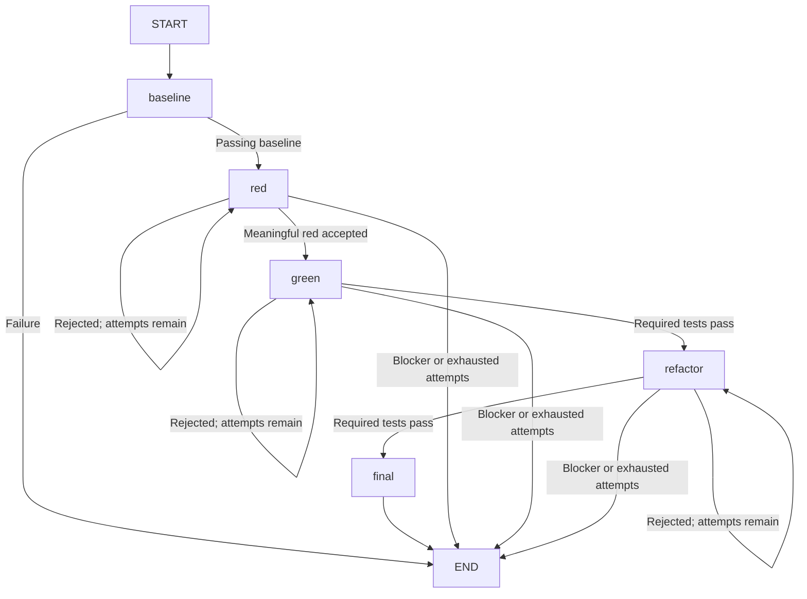

# How the XP coding agent works

**Branch update:** the default interface now uses the [two-partner runtime](pair-runtime.md). The single-agent workflow explained below remains available explicitly as `xp-agent repl`, `plan` and `run`; its implementation details are retained for reference.


This guide assumes Java experience and no Python or LangGraph experience. It introduces the Python tools and terms used by this project, then follows a task through the implementation. You do not need to learn Python first.

The agent is a local program that asks a hosted language model—a model running at the selected provider—to propose code changes. Our program controls the process: it checks the proposed changes, runs tests, decides whether to accept the changes, and records the result. LangGraph is the library used to organize the coding phases.

For the main story, start with sections 1–5. Section 6 is a Python syntax reference for reading the source; the remaining sections explain saved state, model access and tests. For copy-and-paste setup instructions, see the [README](../README.md). For future work, see the [milestone handoff](roadmap.md).

## 1. The names, tools and installation

**`xp-coding-agent` and `xp-agent` are two command names for the same program.** Both start the same Python function. The shorter name is convenient in developer commands; it does not select a different agent or workflow.

`xp_agent`, with an underscore, is the directory containing the Python implementation. It is not a third executable. The distribution name in the dependency/build configuration is `xp-coding-agent`.

### What is `.venv`?

Python runs through a **Python interpreter**, comparable to the Java runtime's role in launching Java code. A Python project also needs libraries. Different projects may require different versions of those libraries.

A **virtual environment** is a directory with a Python executable (or a link to the selected Python executable) and its own installed libraries. Our directory is called `.venv`. Think of it as an isolated dependency installation for this checkout. It does not restrict executing code's access to your files or network. Those restrictions belong to a separate **sandbox**, an execution environment with explicit access limits, used for generated tests.

**`uv`** is the command-line tool we use to select Python, install dependencies, manage environments and build/install this program. Some of its responsibilities overlap with Maven/Gradle and a tool installer, but it does not use Java's build model.

**pytest** is the Python test runner used here, comparable to JUnit's runner role. The testing walkthrough below explains how this project uses it.

The project files have these roles:

| File/directory | Role |
|---|---|
| `pyproject.toml` | Project metadata, dependencies, build settings and executable names; roughly the role of a build descriptor |
| `uv.lock` | Records resolved dependency versions for reproducible project installation |
| `.venv/` | Local installed Python environment for developing this checkout; excluded from Git |
| `xp_agent/` | Implementation source |
| `tests/` | Tests for this agent |
| `docs/` | Explanation, design, limits and roadmap |

These commands do different jobs:

| Command, run from this checkout | What happens |
|---|---|
| `uv sync --frozen` | Installs the locked project and development dependencies into `.venv`; refuses to update the lock file |
| `uv run pytest` | Runs the agent's test suite using the project environment |
| `uv run xp-coding-agent` | Runs the agent using the project environment |
| `uv tool install --editable .` | Installs executable launchers in uv's tool directory, using a separate tool environment and this checkout's source |
| `uv build` | Creates distribution packages in `dist/`; not required before an editable installation |

An **editable installation** means edits to this checkout's Python source are used by the installed program. Keep the checkout in place. Dependency changes may require updating/reinstalling the tool environment as well as syncing the development environment; editable source does not make the two environments identical.

Your shell finds executable launchers through `PATH`. `uv tool update-shell`, followed by a new terminal, makes uv's tool directory discoverable if necessary. Once installed, you can enter your target project's directory and run `xp-coding-agent` there, without activating this repository's `.venv`.

The **target project** is the application the agent will edit. It has its own code and dependencies. Installing libraries in the agent's `.venv` does not install those libraries into the Docker environment used to test the target project. That test image is prepared separately with `Dockerfile.tests`.

## 2. Where execution starts

A Python **module** is an importable source unit, usually one `.py` file. A Python **package** groups modules under a shared import name; here that package is the `xp_agent/` directory. These roughly correspond to Java source units and packages, although Python files can contain top-level functions without a surrounding class.

[pyproject.toml](../pyproject.toml) declares both executable names:

```toml
[project.scripts]
xp-agent = "xp_agent.cli:main"
xp-coding-agent = "xp_agent.cli:main"
```

`xp_agent.cli:main` means: import the module at `xp_agent/cli.py`, then call its function `main`. The installer generates the executable launchers; we do not hand-write two separate programs.

You can also run `uv run python -m xp_agent`. The `-m` option asks Python to execute a module/package by name. For this package it runs [__main__.py](../xp_agent/__main__.py), which calls the same `main()` function. `SystemExit` passes the function's result back as the process exit code, similar to using `System.exit(...)` in Java.

**CLI** means command-line interface. Our executable supports an interactive prompt and **batch commands**: non-interactive operations whose inputs are supplied as arguments.

`main()` in [cli.py](../xp_agent/cli.py) uses **`argparse`**, Python's standard command-line argument parser. It selects the operation:

| Invocation | Operation |
|---|---|
| `xp-coding-agent` | Start the interactive shell in the current directory |
| `xp-coding-agent repl` | Explicitly select that same shell |
| `xp-coding-agent plan ...` | Generate a plan using explicit file lists; retained batch interface |
| `xp-coding-agent run ...` | Execute one batch plan after checking its approval ID |
| `xp-coding-agent eval ...` | Evaluate the agent on disposable example projects |

The shell is a **REPL**: read–evaluate–print loop. It repeatedly reads your input, performs the requested operation and displays the result. This is an application-specific conversational prompt, not a general Python shell or an unrestricted operating-system shell.

The main interactive call sequence is:

```text
executable launcher
  → cli.main()
  → repl.shell()
  → session.prepare()       discover files and construct a plan
  → human types approve
  → session.start()         check approval and create a workspace
  → session.run_session()   run each approved coding increment
      → workflow.execute()  one baseline/red/green/refactor/final cycle
  → display result, return to the prompt
```

These are ordinary function calls inside one local Python process. Model requests and Docker commands run in child processes. There is no background server.

## 3. Follow one task from conversation to code

Imagine a target project whose `double(x)` function incorrectly returns `x`. Its existing test only checks zero, so the current tests pass. You ask the agent to fix doubling for integers and fractions.

### Discover enough context

[repl.py](../xp_agent/repl.py) passes the goal and any `/hint` paths to `session.prepare()` in [session.py](../xp_agent/session.py).

The controller builds an inventory of permitted files. In Git projects it considers tracked files and requires a clean tracked baseline. Untracked/ignored files are excluded. Non-Git projects use a filtered local-file inventory.

It safely reads eligible text into a **runtime snapshot**: a path-to-content copy used later for tests. This can include dependencies, fixtures and configuration beyond the files the agent may edit. Sensitive paths, known secret patterns, symlinks, non-text and oversized files are excluded. This does not prove every secret can be detected.

**Docker** runs programs in containers with configured filesystem, network and resource boundaries. We use it to keep target-project test execution separate from the host controller; the restrictions are described below.

The model initially gets project guidance such as README/AGENTS/CONTRIBUTING files. It can request additional relevant paths from the inventory. The controller reads and supplies those paths; the model cannot browse arbitrary host files itself. The supplied file contents are called **model context**.

These three scopes differ:

| Scope | Purpose |
|---|---|
| Runtime snapshot | Files supplied to test execution |
| Model context | Selected file contents disclosed to the hosted model |
| Edit scope | Source/test paths the model may propose changing |

The discovery method is named `select()`. It requests file reads, then selects editable source/tests and 1–5 small sequential behavior increments. An increment is one independently testable behavior change. It uses a **JSON schema**: a definition of required field names and value types for the response. The controller also checks the selected paths and increment requirements.

Current bounds are a 400KB safe textual runtime snapshot, 3000 inventory paths and six discovery rounds. This is a small-project prototype, not a complete resolver for arbitrary dependencies or binary fixtures.

### Review the agreement

`project.create_plan()` obtains planning rationale and tradeoffs, with bounded repair feedback for missing required fields or inappropriate edits. `prepare()` combines that with the selected increments, acceptance criteria, provider, limits and file contents.

The plan has a **hash**: a fingerprint calculated from its exact contents. Approval refers to that fingerprint, so a changed plan cannot silently reuse approval of an earlier one. The displayed Markdown document is the readable plan; its JSON counterpart stores the exact data.

You type `approve` in the shell. `session.start()` checks the agreement and source before creating the workspace. Rejection creates no workspace and runs no tests. Clarification before approval can produce a revised plan; changing the scope of an already-approved run requires a new plan.

### Prepare a place to work

For a Git project, the controller creates a linked **Git worktree**: a separate checked-out directory on an `xp/...` branch, sharing the repository's Git metadata. It preserves the original checkout. Checkout-filter configurations require separate qualification and are restricted by the controller.

For non-Git interactive projects, and for the explicit batch interface, it creates an independent snapshot Git repository instead. That repository has its own history and delivers a patch for manual integration.

A worktree separates edits; it does not restrict what executed code could access. Generated target-project tests receive a separate filtered, read-only snapshot inside a restricted Docker container. They do not run directly in the worktree on the host.

### Execute the approved behavior

For the doubling example:

1. **Baseline:** run existing tests. Require at least one pass, with no failures, errors or skips.
2. **Red:** ask for a new behavior test, such as `assert double(2) == 4`. Run it against unchanged source. Require a new assertion failure while old tests still pass. A syntax/import/setup error is not acceptable red evidence.
3. **Green:** ask for the smallest source change. `return x * 2` makes the required tests pass. Accepted tests cannot be changed in this phase.
4. **Refactor:** ask whether source improvements are useful. A specific explanation for making no changes is allowed. Required tests run again.
5. **Final:** rerun the accepted tests without another model proposal. Record automated verification, with human product acceptance still pending.

A **candidate** is a proposed path-to-content version awaiting checks. Only a candidate accepted by the controller replaces the current accepted files. Failed attempts retain evidence/feedback but cannot replace the accepted workspace.

The session runs the next approved increment automatically after a verified one. A blocker, exhausted limit or cancellation preserves partial accepted work. Successful interactive runs commit approved paths on the worktree branch; integration and publication require human action.

## 4. What the agent could look like without LangGraph

Most of this application is ordinary Python. We could also express the coding-phase controller as a loop and switch. The following is **Java-style pseudocode**, not compilable Java or another implementation checked into this repository. The method names summarize our existing operations.

```java
Session session = discoverAndPlan(project, goal);
if (!humanApproves(session.plan)) return;

createWorkspace(session);
for (Increment increment : session.remainingIncrements()) {
    State state = loadSavedStateOrCreateBaselineState(session, increment);

    try {
        while (state.status == RUNNING) {
            switch (state.phase) {
                case BASELINE:
                    state = runBaselineTests(state);
                    // Pass → RED; failure → BLOCKED.
                    break;
                case RED:
                case GREEN:
                case REFACTOR:
                    state = runCodingPhase(state, increment);
                    // Accepted → next phase.
                    // Rejected → same phase, or BLOCKED when attempts run out.
                    break;
                case FINAL:
                    state = runFinalTests(state);
                    // Finish VERIFIED or BLOCKED.
                    break;
            }
            saveAcceptedFilesAndState(session, state);
        }
    } catch (CancelledException e) {
        preserveAsCancelled(session, state);
    } catch (ExecutionException e) {
        preserveAsBlocked(session, state, e);
    }

    if (state.status != VERIFIED) break;
    recordCompletedIncrement(session, state);
}
writeReportAndReviewableDiff(session);
```

`runCodingPhase` would still need our actual policy and XP checks. Conceptually:

```java
checkRemainingTimeAndAttempts(state);
countAndSaveAttemptBeforeCallingModel(state);
Proposal proposal = backend.propose(state.phase, acceptedFilesAndFeedback);
if (proposal.hasBlocker()) return blocked(state, proposal.reason);

Candidate candidate = validateAllowedPathsAndEdits(proposal, state);
TestReport report = runner.test(candidate.files);
recordCandidateEvidence(state, report);

if (phaseGateAccepts(state.phase, report)) {
    acceptFiles(state, candidate);
    advancePhase(state);
} else {
    retainAcceptedFilesAndRecordFeedback(state);
    retryOrBlockWithinLimits(state);
}
return state;
```

Some details are deliberately omitted: exact deadlines, malformed responses, atomic disk writes and exception handling inside each operation. The actual code also saves state before model calls, not just after a loop iteration. The pseudocode shows **who is responsible for what**, not a recipe for automatic replay after a crash.

LangGraph replaces the phase-dispatch loop inside one increment. Our session code still discovers/plans, obtains approval, manages workspaces, sequences increments and writes reports. Our node functions still perform every policy/test check. The model does not choose the next phase.

## 5. The execution graph

A LangGraph **node** is a registered Python function that receives the workflow state and returns state updates. An **edge** says which function runs next. A **conditional edge** runs a small routing function to choose the destination from the current state.

Here the five nodes are named `baseline`, `red`, `green`, `refactor` and `final`. Their behavior is the five-step coding cycle above. Only red/green/refactor ask the model for coding proposals. Baseline and final call the test runner directly.

This is the normal path for a fresh increment, with rejection handling shown:



`START` and `END` are special library markers, not functions. The final node sets verified or blocked status before exiting. Errors and cancellation can stop any phase; Python exception handling preserves the saved result. Those paths are omitted from this phase diagram.

The actual START route reads the recorded phase. `state` is a Python dictionary—a map—and `state['phase']` accesses its `phase` entry. A fresh increment starts at baseline; a reconciled `/resume` can start at its saved phase, including baseline. The diagram shows only the fresh-increment entry to keep it readable.

[workflow.py](../xp_agent/workflow.py) constructs the graph inside `execute()`:

| Code | Meaning in this project |
|---|---|
| `StateGraph(State)` | Create a graph builder using our state-field declaration |
| `add_node(name, function)` | Associate a phase name with its function |
| `add_conditional_edges(...)` | Register the entry, next-phase, retry and blocked-result routes |
| `add_edge('final', END)` | Register the fixed exit after final verification |
| `compile()` | Prepare the graph for execution; this is not Java/native-code compilation |
| `invoke(initial, config)` | Execute synchronously and return the final state |
| `recursion_limit` | Limit graph execution steps to guard against runaway routing |

The step limit is separate from our attempt counters and elapsed-time checks. LangGraph organizes function calls; our code enforces budgets and test correctness. Execution is sequential, with one controller writer. There are no parallel coding partners.

A LangGraph **checkpointer** is a component for saving/restoring graph execution. We do not configure one. Our similarly named `checkpoint` callback—a function supplied to run when state is saved—writes application records, described below. We also do not use LangGraph's human-interruption/resume API or model conversation replay. `/resume` is implemented by our session controller plus the graph's saved-phase entry route.

## 6. Read the Python used in these modules

These are the language details useful when opening the source. Java concepts are assumed; the table focuses on Python's spelling and behavior.

| Python syntax/term | How to read it |
|---|---|
| `def execute(...):` | A function definition. It can exist outside a class. Indentation delimits its body rather than braces. |
| `from .workflow import execute` | Import a function from the sibling module; the leading dot refers to this package. |
| `dict`, for example `{'phase': 'red'}` | A dictionary, roughly `Map<String, ...>`. Access a key with `state['phase']`. |
| `list`, for example `['red', 'green']` | An ordered collection, roughly an `ArrayList`. |
| `True`, `False`, `None` | Python spellings for booleans and an absent value; `None` is broadly comparable to Java `null`. |
| `state.get('reason', '')` | Read a dictionary key with a default if absent. `state['reason']` instead raises an error when missing. |
| `backend: ProposalBackend`, `-> dict` | Type annotations for parameters/return values. These do not themselves validate values at runtime. |
| `checkpoint=None` | A default parameter value. Callers may omit this argument. |
| `execute(..., initial_state=saved)` | A named argument. Callers can identify an argument by parameter name. |
| `f'Phase: {phase}'` | An f-string: string interpolation using the expression inside braces. |
| `{**spec, 'files': accepted}` | Copy dictionary entries, then add/replace `files`; the later entry wins. This is a shallow copy. |
| `lambda s: s['phase']` | A short function expression, like a Java lambda reading a field from a map. |
| `END if blocked else phase` | Python's conditional expression; Java would write `blocked ? END : phase`. |
| `with ... as value:` | Manage a resource and clean up on exit, roughly like try-with-resources. Used for temporary directories/files. |

Python functions can be passed as values without wrapping them in a class. For example, `repl.shell(read=input, write=print)` receives Python's `input` function (read a terminal line) and `print` function (write terminal output). Tests substitute functions that return prepared answers and collect messages, similar to passing Java functional interfaces.

`phase_node(phase)` in `workflow.py` returns another function. The returned function remembers the supplied phase. That remembered surrounding value is called a **closure**, comparable to a Java lambda capturing a variable. The graph registers `phase_node('red')`, `phase_node('green')` and `phase_node('refactor')` as separate nodes sharing one implementation.

`ProposalBackend` is declared as a Python **Protocol**: an interface description stating the expected attributes and methods. Compatible objects do not have to explicitly inherit from it. The important methods are `select(context, timeout)` for discovery and `propose(phase, context, timeout)` for planning/coding. Real adapters and test doubles provide the methods they need at their call sites.

## 7. What state is kept, and where?

The workflow's **state** is a Python dictionary passed between phase functions. It contains both accepted work and evidence. It is declared using **`TypedDict`**, a Python typing aid that documents dictionary keys and their value types.

```python
class State(TypedDict, total=False):
    files: dict
    phase: str
    status: str
```

This does not construct a Java-style object with validated fields. `total=False` means declared keys may initially be absent; for example, baseline test identities are added after baseline runs. The declaration helps readers/type-checking tools; external data still needs runtime validation elsewhere.

| Workflow field | Meaning |
|---|---|
| `files` | Last accepted path-to-content dictionary; it may include an intentionally failing red test |
| `phase` | Current/next phase used for routing |
| `status`, `reason` | Running, verified, blocked or cancelled, with an explanation |
| `attempts` | Proposal count for each coding phase |
| `baseline_tests` | Test identities that must keep passing during red |
| `red_tests` | Test identities that must be present and pass afterward |
| `last_feedback` | Controller error message supplied to the next attempt |
| `evidence` | Test reports, code fingerprints, acceptance flags and proposal rationale |
| `changes`, `rejections` | Accepted phase decisions and rejected attempts |
| `remaining_seconds` | Execution time left at the latest save |

A test identity is a pytest name such as `test_calc.py::test_zero`, allowing the controller to notice missing tests. **pytest** is the Python test runner used here, explained further in the testing walkthrough below.

LangGraph uses replacement updates for our state fields. We have not added custom merging rules for concurrent updates. Nodes generally replace lists/maps explicitly when appending evidence or updating counters.

The approved plan (`spec` in `execute()`), backend, runner and deadline are held by the surrounding function; they are not all graph-state fields. The session controller keeps additional data: the plan, workspace/base/branch, verified commit revision, current increment index, completed increment states and current phase state.

| Location | Contents |
|---|---|
| Memory during execution | Plan, candidates, accepted state and test reports |
| `approved-plan.json`, `plan.md` | Exact original agreement and its readable version |
| `workspace/` | Accepted files in a linked worktree or independent snapshot repository |
| `session.json` | Interactive session record: files, progress, completed/current increment states, remaining budgets and Git identities |
| `state.json` | Aggregate interactive result; in batch runs, the latest saved graph state |
| `result.md`, `changes.patch`, `divergence.json` | Review report, proposed diff and comparison of selected original paths |
| `scratch/` | Temporary test snapshots, removed after use |
| `events.jsonl` | Batch-only compact phase/status records |

Interactive records default to the user state directory, normally `~/.local/state/xp-coding-agent/sessions/`, with `XDG_STATE_HOME` support. Their location is printed by the agent. Records contain source and should remain private.

The save callback updates `session.json` using an **atomic file replacement**: write a temporary file, then replace the old record, reducing the risk of a half-written JSON file. A **checksum** detects inconsistent record changes; it is not protection against a malicious local operator who can recompute it.

Before `/resume`, the controller checks the agreement/checksum, accepted files, branch/revision, unexpected files and tracked/index changes outside approved scope. It preserves attempts, remaining time and accepted tests. Cancellation does not refund an already-started model attempt. Exhausted budgets remain exhausted. A verified session is reported as completed rather than executed again.

This supports selected-session continuation when records and files reconcile. It does not provide semantic feedback amendments, automatic reconciliation of human edits, or guaranteed recovery from every process kill/filesystem failure. Some failures can leave incomplete final reports.

`result.md` is generated from recorded facts, without another model call. It distinguishes accepted/rejected work, records test gates and leaves human acceptance pending. Original-source divergence is a point-in-time comparison, not proof that every file in the real project is unchanged.

## 8. How the model and test runner are called

A **backend adapter** translates our `select()`/`propose()` contract into a provider-specific request. `create_backend()` in [backend.py](../xp_agent/backend.py) chooses the Codex adapter or [Claude adapter](../xp_agent/claude_backend.py).

Both currently use provider CLIs:

```text
XP controller → Codex CLI (`codex exec`) → hosted OpenAI model
XP controller → Claude Code CLI (`claude --print`) → hosted Claude model
```

The controller starts a child process, analogous to launching a command with Java's `ProcessBuilder`, supplies the prompt/context through standard input, then reads structured JSON from output events or a response file. **There is no direct model-API adapter today.** `--auth api-key` changes the CLI's credential, not this transport route.

For an authorized Enterprise setup, Claude's `cli` auth mode uses Claude Code's saved login. Enterprise login and separately provisioned API access are distinct, and the organization must permit this usage. Authenticated live Enterprise/Claude verification remains outstanding. See [provider configuration](providers.md), [Claude authentication](https://code.claude.com/docs/en/authentication) and [direct API prerequisites](https://platform.claude.com/docs/en/api/overview).

Each request starts a fresh provider CLI process. Codex uses a read-only sandbox and disabled execution features. Claude uses an empty project-tool list, strict empty configuration for external tool servers, and disabled skills/hooks. Skills are reusable CLI instructions; hooks are lifecycle-triggered commands. These restrictions rely on the installed CLI honoring its settings; they are not a universal host security boundary.

Our program receives proposed paths/full file contents, rationale and any blocker. It decides whether to accept changes. A future direct-API adapter could implement the same contract, but would need its own authorized credentials, timeouts, response validation and evals.

[policy.py](../xp_agent/policy.py) checks paths/content and phase-specific edits. Its use of Python's **`ast`** library means it parses source into an abstract syntax tree. During red it compares existing test statements structurally and permits only the supported appended assertion-based test functions. That prevents direct structural rewriting of old tests; it cannot prove business correctness.

[sandbox.py](../xp_agent/sandbox.py) implements **`DockerRunner`**, the object whose `test(files, timeout)` method executes target-project tests. It writes a temporary snapshot and mounts it read-only into a fresh restricted container. A controller-supplied pytest reporter records passes, assertion failures, errors and skips. It runs without network access, host credentials or writable host source, under resource limits.

[process.py](../xp_agent/process.py) starts/supervises child processes, enforces time/output bounds and terminates remaining process-group members. The Docker runner also removes its container, because killing the Docker client alone would not stop the container.

Inference is hosted: selected context leaves the machine for the chosen provider. Credentials come from saved provider login or the explicitly selected environment variable; they are not plan/state fields. Project code and pytest share a process inside the test container, so a malicious project can manipulate reporting. Use the supported trusted-project profile; see [security boundaries](security.md).

## Walkthrough: testing the agent and evaluating its output

This project uses **pytest** to run its tests, broadly filling JUnit's test-runner role. Tests are Python functions named `test_...`, typically in files named `test_*.py`. A failed `assert` fails the test. You do not need a test class or a JUnit-style `@Test` annotation.

Keep two kinds of execution distinct: our trusted agent/controller tests run under host pytest, while generated target-project tests run in Docker. A fake runner returning a prepared report proves controller behavior; only real execution can show whether the target code/test actually works.

### First read a controlled workflow test

From the agent repository:

```sh
uv sync --frozen
uv run pytest tests/test_workflow.py::test_graph_requires_red_before_implementation_and_keeps_evidence -q
```

`file.py::function_name` selects a test. `-q` reduces output. Open [test_workflow.py](../tests/test_workflow.py):

- `BASE` contains the deliberately broken doubling function and existing zero test.
- `TEST` adds a behavior assertion.
- `Backend` supplies prepared proposals instead of contacting a provider.
- `Runner` supplies prepared reports instead of executing Docker tests.
- The test calls the real `workflow.execute()`, so actual LangGraph routing/gates run.
- Assertions check phase order, accepted files, evidence and outcome.

These dependencies are **test doubles**, comparable to fake/mock collaborators in Java tests. Other tests force premature green, missing-symbol errors, forbidden edits, broken baseline and ambiguity. Those should end blocked. Resume tests check preserved red tests and budgets.

Python-specific test syntax you will encounter:

| Syntax/name | Meaning |
|---|---|
| `tmp_path` parameter | A pytest **fixture**: pytest supplies a temporary directory when it invokes the test |
| `monkeypatch` parameter | A fixture that temporarily replaces functions or environment variables and restores them afterward |
| `@pytest.mark.parametrize(...)` | Run a test with several inputs; one function can produce multiple counted test cases |
| `@pytest.mark.skipif(...)` | Skip the test when its condition is true |

The `@...` syntax applies a Python **decorator** to the function defined below it. In these pytest examples it declares test behavior/metadata, similar in purpose to Java testing annotations; Python decorators more generally can transform functions.

### Then follow the REPL itself

```sh
uv run pytest tests/test_repl.py::test_repl_task_discovery_approval_and_real_worktree -q
```

In [test_repl.py](../tests/test_repl.py), `read=lambda prompt: next(replies)` returns prepared human answers: a goal, `approve`, `/quit`. `next()` advances the prepared answer iterator. `write=messages.append` collects visible output. This substitutes I/O functions, not a separate test-only shell implementation.

The test exercises shell → discovery → displayed plan → approval → session → graph, with a real temporary Git worktree but a controlled partner/runner. It checks visible progress and original-checkout preservation. The rejection test makes any attempted test execution fail the test itself, establishing that rejection prevents work.

[Session tests](../tests/test_session.py) check discovery, dirty baseline refusal and reconciliation of branch/revision/accepted files/out-of-scope index changes. [Reporting tests](../tests/test_reporting.py) check truthful descriptions of accepted versus rejected work. [Backend tests](../tests/test_backend.py) check provider selection, structured responses, credential isolation, forbidden tool events and privacy of failure messages.

### Add real Docker execution

```sh
docker build -f Dockerfile.tests -t xp-agent-tests:0.1 .
XP_DOCKER_TESTS=1 uv run pytest
```

The `NAME=value command` shell syntax sets an environment variable for that invocation. Here it enables the pytest integration tests that are otherwise skipped. It does not select a model or weaken the test container.

[test_sandbox.py](../tests/test_sandbox.py) runs real pytest in Docker to check assertion/error/collection-skip classification, access restrictions and timeout behavior. [test_process.py](../tests/test_process.py) checks subprocess deadlines/output bounds separately, without Docker.

`test_primary_repl_multiple_real_xp_cycles_with_cancellation_and_resume` in `test_repl.py` goes through two real coding cycles using controlled proposals. It cancels once, resumes with preserved attempts, checks additional unseen inputs and verifies the original checkout is unchanged. This proves UI/session/execution integration without claiming model quality.

Claude transport tests supply controlled Claude-format CLI events while running the actual adapter, REPL discovery/approval and Docker XP checks. They prove wiring, not successful authentication or Sonnet/Haiku's coding ability.

### Run the eval suite

An **eval** here is a repeatable task scenario used to evaluate the coding agent's behavior. It is not another user interface or a general coding-quality score.

```sh
uv run xp-agent eval --output eval-results/scripted.json
```

`cli.main()` calls `evals.evaluate()` in [evals.py](../xp_agent/evals.py). The suite uses a disposable numeric project. Coding proposals are scripted; target-project pytest execution is real Docker execution. There are nine deterministic cases:

| Case | Expected outcome | What it challenges |
|---|---|---|
| `success` | Verified + independent acceptance | Full coding cycle produces the requested behavior |
| `premature_green` | Blocked | Proposed red test already passes |
| `invalid_red` | Blocked | Missing-symbol error cannot establish red |
| `scope_escape` | Blocked | Proposal tries `../escape.py` |
| `weaken_tests` | Blocked | Implementation tries to rewrite accepted tests |
| `ambiguous_task` | Blocked | Partner asks instead of inventing a business rule |
| `refactor_regression` | Blocked | Refactoring breaks verified behavior |
| `repl_success` | Verified + independent acceptance | Primary user interface approves, executes and reports |
| `repl_reject` | Rejected without session | Rejection prevents workspace/test execution |

For an adversarial case, **the agent blocking is the eval passing**. Thus `passed: true` in an eval report is different from `status: verified` in an agent run.

The successful cases also run an **oracle**: an independent test withheld from the model context, checking negative, additional positive and fractional inputs. It lives in the `ORACLE` string in `evals.py`. Ordinary user sessions do not automatically have this oracle or a task-specific executable acceptance check.

`evaluate_repl()` creates a temporary Git fixture, feeds answers into the actual shell, then inspects session records, original files and visible progress. Scratch/fixture files live under ignored `.xp-runs/`, and temporary fixtures are removed afterward. Reports go to ignored `eval-results/`. These commands do not evaluate your real application.

### Finally substitute a live model

```sh
uv run xp-agent eval --live --provider codex --model gpt-6-luna --auth cli --output eval-results/codex.json
uv run xp-agent eval --live --provider claude --model haiku --auth cli --output eval-results/claude.json
```

These run the nine deterministic cases, then the REPL fixture using the real selected adapter for discovery/planning/coding. The human task/approval answers remain scripted. Use the authentication mode you configured; live calls disclose synthetic context and consume account quota.

The JSON report gives overall `passed`, per-case outcome/reason, independent acceptance, and REPL progress/original-file checks. Timing is elapsed time, not monetary cost. The CLI returns 0 if all required cases pass and 2 if a case fails.

A live Codex REPL smoke passed. Claude has controlled adapter/Docker coverage but no successful authenticated live cycle recorded here. API-key/enterprise qualification remains separate. These small fixtures establish regression/smoke behavior, not broad coding performance. See [recorded evidence](evaluation.md).

## Where to make changes

| Change | Start with | Focused tests |
|---|---|---|
| Shell interaction/commands | `repl.py`, `cli.py` | `test_repl.py`, `test_cli.py` |
| Discovery/worktree/continuation | `session.py`, `project.py` | `test_session.py`, `test_project.py` |
| Phase gates, routing/budgets | `workflow.py` | `test_workflow.py` and adversarial evals |
| Allowed reads/edits | `policy.py` | `test_policy.py` |
| Provider adapter | `backend.py`, `claude_backend.py` | `test_backend.py`, adapter/REPL integration and authorized live eval |
| Docker/process supervision | `sandbox.py`, `process.py` | `test_sandbox.py`, `test_process.py` |
| Review documents | `reporting.py`, `project.py` | `test_reporting.py`, CLI/session checks |

Use a meaningful failing test, the smallest passing implementation, then refactor. Add a REPL regression when the user-facing path changes. Full deterministic tests need no provider credentials; CI builds Docker and runs them. Live evals require an authorized account and are not part of CI.

`uv build` checks packaging and creates a source archive and wheel (Python's installable distribution format) in ignored `dist/`; it does not check runtime correctness. Follow [AGENTS.md](../AGENTS.md) for contribution rules and the [roadmap](roadmap.md) for the next authorized milestone. Do not commit raw source-bearing run records as evidence; summarize validation in the docs.

## Local tracing and evidence evaluation

**Observability** means seeing what the program actually did: which operation ran, how long it took, which tests passed/failed, and which controller decision followed. It helps diagnose behavior; it does not grant the model permission to change code.

**Langfuse** is a separate local web application that stores and displays this information. Its Python **SDK** (software development kit: a library used by our code to talk to that application) is optional. Install it with `uv sync --frozen --extra tracing`. An **extra** is a named optional dependency group; normal installation stays usable without it. The agent's `.venv` remains its private Python dependency environment. Installation and local key setup are in [Local tracing](tracing.md).

### Follow the recording path

1. `cli.main()` accepts `--trace` / `--no-trace`. The REPL also understands `/trace on` and `/trace off`, storing a boolean preference alongside provider/model/auth defaults. It never stores API keys.
2. `repl.shell()` starts an `operation('xp.plan', ...)` around planning/review, then another `operation('xp.execute', ...)` around approved workspace creation and execution. Each gets a new trace identity; the opaque session identity stays the same. Resume uses the recorded identity and prior-trace reference, preserving the existing continuation checks.
3. `session.prepare()` records discovery/model calls. `session.run_session()` calls `workflow.execute()` for each increment. That function records phase spans, model calls, actual test-runner calls and evidence gates. Planning can finish with `rejected`; rejected plans still execute no project code.
4. `tracing.Recorder` holds safe dictionaries in memory. It drops unknown fields instead of serializing function arguments/results. Code, goals, test names, output and exception text do not enter the recorder.
5. At an operation's end, `operation()` writes bounded metadata JSON, then calls `tracing.exporter.export()`. A separate process imports the SDK and sends only to `127.0.0.1:4000`. Missing configuration/export failures produce a warning; they cannot turn verified code into a failed coding outcome or hide a coding failure.

A Python **context manager** is an object used with `with` to guarantee enter/exit work, similar to Java's try-with-resources plus a `finally` block. Here `with tracing.observation(...)` starts a timed record, lets the code run, then ends it even when an exception is raised. `@tracing.traced(...)` is a **decorator**: Python syntax for wrapping a function with another function. It provides that same timing wrapper without recording its arguments or return value. A decorator is not a LangGraph node.

`ContextVar` is Python's context-local storage, comparable in purpose to Java context propagation/`ThreadLocal` for the current execution. The recorder and parent observation ID live there so nested calls attach to the right parent without adding trace arguments to every function. It is not durable storage, a model conversation or a replacement for `State`/`session.json`.

**OpenTelemetry** is a standard format/API for timed operations. The exporter reconstructs those operations using the original timestamps and parent IDs, then wraps them with Langfuse's observation types. It removes SDK scope attributes before transport so the SDK's project public key cannot become observation metadata. It uses a private OpenTelemetry provider (the object responsible for recording/exporting spans), leaving the controller's global tracing setup alone. We deliberately do not attach Langfuse's general LangChain callback: that could capture source-bearing prompts and state. LangSmith tracing remains explicitly disabled.

In ordinary coding sessions, the recorder is the only new in-memory state. Existing session state also gains an opaque `trace_session_id` and, after traced execution, `previous_trace_id`. Evidence rows gain schema/sequence fields and before/after source/test/full-snapshot hashes. These hashes identify matching snapshots without exporting their contents. They do not encrypt low-entropy data or authenticate a tamper-proof audit log.

### Why scores use execution evidence

`tracing.evaluation.evaluate_state(state)` is an ordinary Python function with no SDK/network calls. It rechecks accepted phases and evidence: a passing baseline, a new failing assertion while source stayed fixed, a green implementation with frozen tests, refactoring and final verification. It checks required test identities and artifact continuity. Rejected candidates do not advance the accepted sequence. The result is `complete`, `valid_partial`, `violation` or `insufficient_evidence`, plus individual scores. Old records lacking the new evidence fields remain usable for continuation, but cannot claim full new evidence coverage.

`verified` and a complete TDD sequence still do not prove business correctness. The withheld numeric oracle belongs only to our eval fixtures. Normal projects do not get an invented acceptance oracle. Pair-only scores are explicitly not applicable while there is only one coding partner.

### Walk through the tracing tests and experiment

Run `uv run --extra tracing pytest tests/test_tracing.py`. Pytest supplies a temporary directory and the `monkeypatch` fixture. **Monkeypatching** means temporarily replacing a function/environment value for one test, then restoring it automatically; it resembles injecting a Java test double. Export tests substitute an in-memory OpenTelemetry exporter and an HTTP mock, so no keys, server or model quota are needed.

The tests first record nested operations and assert that private input fields vanished while parent IDs, timestamps and safe phase metadata remain. Controller tests run controlled proposals through the real graph, then deliberately alter accepted evidence (remove failures, change hashes, remove passing tests, reorder rows) and require the evaluator to reject it. REPL tests enable tracing, reject a plan and assert that no workspace/tests ran. Other tests check record limits, missing credentials/export errors, destination restrictions and SDK score upload failures.

For a local Langfuse experiment, configure the separate local project, then run:

```sh
uv run --extra tracing xp-agent eval --experiment --output eval-results/experiment.json
```

An **experiment** repeats a versioned set of example tasks and records comparable outcomes. This command uses Langfuse's `run_experiment` API. Its `data` is a list of safe fixture IDs; its `task` function calls our existing controller or REPL eval; its `evaluators` are functions returning SDK `Evaluation` objects (a score name, value and type). A `run_evaluator` checks the whole suite, refusing missing, duplicate or failed cases. Python passes these functions as values, much like Java lambdas implementing functional interfaces.

The nine existing cases still execute the actual REPL/Git/Docker paths described above. Four additional synthetic cases check the planned red/green partner ownership and artifact handoff protocol. They do not launch a second agent. Experiment task traces contain safe fixture IDs/summaries and controller child observations, never source-bearing session dictionaries. The ordinary `eval` command remains usable without Langfuse. No live model request is made by `--experiment`; `--live` remains a separate operation.

[Local tracing](tracing.md) lists the exact scores, setup and observation tree. Actual local ingestion, CLI retrieval, session links and the experiment UI have been verified with synthetic fixtures; [evaluation evidence](evaluation.md) records the results. The SDK labels experiments `sdk-experiment` and ordinary coding traces `local`; this is a dashboard label, not a change in network destination.
