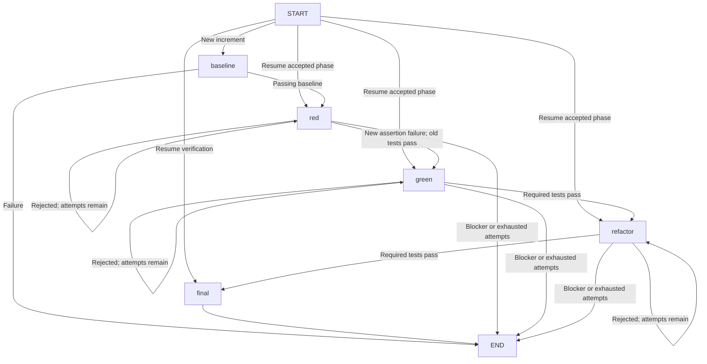

# How the XP coding agent works

This walkthrough assumes you can program, but have not used Python or LangGraph. It explains the implementation that exists today. For installation, authentication, commands and contribution checks, start with the [README](../README.md).

The agent automates an approved goal through one or more small Python behavior increments. A model proposes files; ordinary Python code decides whether those files are allowed; Docker runs tests; LangGraph chooses the next phase. The model cannot declare its own work successful. Human product acceptance remains a separate judgment.

## Start here: the entry point

When you run:

```sh
uv run xp-agent --help
```

`uv` selects the repository's `.venv` Python environment. The `[project.scripts]` section in [pyproject.toml](../pyproject.toml) maps the command `xp-agent` to `xp_agent.cli:main`: the function `main` inside the module `xp_agent/cli.py`.

A Python module is usually a `.py` file. The `xp_agent/` directory is a package, so modules can import one another. For example, `from .workflow import execute` imports a function from a sibling module. The leading dot means “within this package.”

An alternative entry point is:

```sh
uv run python -m xp_agent --help
```

Python executes [xp_agent/__main__.py](../xp_agent/__main__.py), which calls the same `main()` function and passes its return value to `SystemExit` as the process exit code.

`main()` uses Python's standard `argparse` library. Invoking the executable without a subcommand launches the REPL; the explicit `repl` command does the same. Batch subcommands remain available:

| Command | Main operation | Calls the execution graph? |
|---|---|---|
| `repl` (default) | Interactive task, discovery, approval, session execution and continuation | Yes, per increment |
| `plan` | Discover selected files, obtain a proposed plan, save JSON and Markdown | No |
| `run` | Verify approval, create a snapshot, execute XP phases, write results | Yes |
| `eval` | Exercise synthetic scenarios and optionally a real model | Yes, once per scenario |

There is no background server. Each command runs synchronously in a local Python process. Child processes perform model requests and tests.

## Interactive shell, discovery and approval

`main()` calls `repl.shell()` for interactive use. `read=input` and `write=print` are replaceable I/O functions: tests provide scripted human answers and capture the same output a terminal user sees. `xp-coding-agent` and `xp-agent` map to that entry point. Editable global installation lets you invoke it from another project's directory without activating the agent's `.venv`.

The shell passes the current directory, goal and optional hints to `session.prepare()`. For Git projects, the controller inventories tracked paths and requires a clean tracked baseline. For non-Git projects it inventories local files under path policy. It safely reads eligible text for a bounded runtime snapshot; unsafe/non-text/oversized inputs are excluded. No project commands run during discovery.

The provider adapter's `select()` uses a separate discovery JSON schema. It requests relevant read paths over up to six rounds, then selects existing editable source, tests and 1..5 sequential task/acceptance increments. The controller checks those requests against its inventory. The model receives selected context, while the runner later receives the broader safe runtime snapshot for dependencies. Neither role has arbitrary host file access. Current bounds are 400KB and 3000 paths; this is not a general solution for large repositories or binary fixtures.

`project.create_plan()` supplies the shared rationale/tradeoff planning step, with bounded corrective feedback when those required fields are omitted or planning incorrectly proposes edits. `prepare()` binds the runtime/context scopes, increments, workspace strategy, provider, limits and base commit into a version-3 plan hash. A Python dictionary is a key/value map; `plan['files']` maps relative paths to source contents. The Markdown rendering shows the agreement. The user types `approve` directly in the shell; `session.start()` verifies the exact hash/source and creates the workspace. Rejection creates no workspace or test execution.

For a Git project, `create_workspace()` makes a linked worktree with an `xp/...` branch at the approved commit. Git metadata is shared, while checked-out files are separate. The main checkout is preserved. It refuses dirty tracked files and checkout filters rather than running an uncontrolled preparation command. Non-Git interactive projects and explicit batch runs use `make_workspace()`, which creates an independent snapshot Git repository.

`run_session()` runs each approved behavior through `workflow.execute()`, saving accepted files and progress. After a verified increment, it advances automatically to the next with the remaining session time. Human acceptance, integration and publication remain separate.

The legacy batch `plan`/`run` route still accepts explicit paths and exact approval IDs. Its artifact orchestration lives in `cli.perform_run()` and does not use the multi-increment interactive session service. See [batch reference](batch-reference.md).

## The execution graph

The graph is constructed inside `execute()` in [workflow.py](../xp_agent/workflow.py). Discovery, planning, approval, workspace operations, increment sequencing and final Markdown reporting are outside it, in the session controller.



A **node** is a Python function that takes state and returns updates. An **edge** determines which node runs next. This graph is sequential: there are no concurrent coding agents or parallel file writers.

| Node | What its Python function does | Successful transition |
|---|---|---|
| `baseline` | Runs tests on the approved snapshot; requires at least one pass and no failures, errors or skips | `red` |
| `red` | Requests test additions, validates them, runs candidate tests; requires a new assertion failure while baseline tests still pass | `green` |
| `green` | Requests source edits, validates them, reruns all required tests | `refactor` |
| `refactor` | Requests source improvement or a justified no-change decision; reruns required tests | `final` |
| `final` | Independently reruns the accepted snapshot's tests without another model proposal | `END`, with verified or blocked status |

Only `red`, `green` and `refactor` call the model. Baseline and final use the test runner directly. Syntax errors, import errors and skipped tests cannot satisfy the red gate.

The three coding nodes are made by `phase_node(phase)`, a **function factory**. In Python, a function can return another function. The returned inner function remembers the outer `phase` variable; this is a **closure**. Calling `phase_node('red')` creates a node specialized for red without copying the common validation, retry and evidence code three times.

Each attempt starts from accepted files. The controller constructs a separate candidate dictionary, tests it, and promotes it to `state['files']` only after the phase gate passes. Rejected candidates never reach the accepted workspace. A rejected attempt sets feedback and keeps the same phase; an accepted attempt changes the phase. A blocker or exhausted attempt budget sets `status='blocked'`.

## What LangGraph provides here

These are the LangGraph features actually used:

| API / concept | Role in this project |
|---|---|
| `StateGraph(State)` | Defines the shared state shape and graph builder |
| `add_node(name, function)` | Registers the five phase functions |
| `START`, `END` | Special entry/exit markers, not functions that execute project code |
| `add_edge()` | Connects fixed final-to-end transition |
| `add_conditional_edges()` | Selects initial/resumed phase, retry, next phase or termination from state |
| `compile()` | Turns the builder into an executable graph |
| `invoke(initial, config)` | Runs it synchronously and returns the final state |
| `recursion_limit` | Bounds graph execution steps; an additional guard against runaway routing |

The conditional routes use short Python `lambda` functions. For example, `lambda s: END if s['status'] == 'blocked' else s['phase']` returns a destination name based on the current state. It does not call the model to decide where to go.

The `recursion_limit` is not the attempt budget or a wall-clock timeout. Explicit Python counters enforce attempts per phase; `time.monotonic()` and subprocess supervision enforce time limits. The configured graph step limit is `10 + 3 * max_attempts`, providing room for the bounded workflow.

LangGraph does not enforce XP correctness or sandbox code by itself. Those behaviors come from our node functions, policy checks and Docker runner. No LangGraph checkpointer, `interrupt`, `Command`, parallel `Send`, streaming API or subgraph is configured. There is no LangGraph-managed crash resume. The session controller supplies a reconciled initial state to explicit entry routing on `/resume`.

## State: what it contains and where it lives

`State` is declared as `TypedDict(total=False)`. This is a type annotation describing a dictionary's expected keys, not a class with runtime validation. `total=False` allows fields to be absent initially—for example, baseline test identities do not exist until baseline runs. Validation of external model output happens separately in the backend and policy code.

| State field | Meaning |
|---|---|
| `files` | Last accepted path → content mapping; may contain an intentionally failing red test |
| `phase` | Current or next coding phase used for routing |
| `status`, `reason` | Running, verified, blocked or cancelled outcome and explanation |
| `attempts` | Number of proposals attempted per coding phase |
| `baseline_tests` | Test identities that must keep passing during red |
| `red_tests` | All identities from accepted red that must pass in green, refactor and final |
| `last_feedback` | Validation or test-gate failure message supplied to the next proposal |
| `evidence` | Test reports, candidate code hashes, acceptance flags and proposal rationales where applicable |
| `changes` | Accepted phase decisions with changed paths, attempt number and rationale, including no-change refactoring |
| `rejections` | Rejected proposal attempts and the controller's reason |
| `remaining_seconds` | Execution time left, saved without including human waiting |

The graph uses the default replacement behavior for state fields; there are no custom reducers that merge parallel updates. Nodes return the state dictionary. When appending an evidence entry or changing attempt counts, the code generally constructs a new list or dictionary explicitly. `**mapping` is Python's syntax for copying/unpacking map entries; later entries replace earlier keys. For example, `{**spec, 'files': state['files']}` preserves plan context while supplying the latest accepted code.

Not everything is graph state. The approved `spec`, backend, runner, deadline and save callback live in the surrounding `execute()` function and are accessible to its nested functions. An internal `snapshot` dictionary retains the latest saved state for handled exceptions or Ctrl-C.

Storage has distinct roles:

| Location | Contents and lifetime |
|---|---|
| Plan JSON | Approved task, limits and initial source snapshot; persisted before execution |
| Graph state in memory | Accepted files, phase progress and evidence while `invoke()` runs |
| Temporary candidate dictionary | Proposed files awaiting a gate; may be rejected |
| `workspace/` | Latest accepted files, materialized by the controller |
| `session.json` | Interactive accepted state/current increment and remaining budgets, written atomically |
| `state.json` | Aggregate interactive result; in batch runs, latest saved graph state |
| `events.jsonl` (batch only) | Compact phase/status snapshots; not a full replay journal |
| `scratch/` | Temporary materialized test snapshots used by the Docker runner |
| Provider temporary directory | Working directory for an individual model proposal; not a writable project checkout |
| `result.md`, `divergence.json` | Completion report and original-source comparison |

The callback named `checkpoint` is application persistence, not a LangGraph checkpointer. In an interactive session it updates `session.json` with the current increment, accepted files, phase state and remaining time. Completed increment states are retained separately. The record has a consistency checksum; it is not a defense against a compromised local operator.

`/resume` loads the exact selected session, checks its plan/checksum, compares accepted files and checks the branch, recorded revision and changes outside the edit scope. This includes excluded tracked files and staged changes. It refuses unexpected workspace changes. The completed commit revision is recorded too, so a later commit cannot silently inherit a verified result. It preserves test identities, attempts and remaining time, then enters the saved phase through a conditional START edge. A started model attempt counts even if cancelled. Exhausted budgets remain exhausted. Completed sessions are reported as already verified rather than re-executed. No old model conversation is replayed.

Handled cancellation/provider failure leaves accepted work. Abrupt termination or artifact-writing failure can leave incomplete results. Resume is supported only when its recorded state reconciles; semantic feedback amendments and automatic recovery from changed files are not implemented. Batch JSON snapshots retain the older inspection-only behavior.

## Trace one behavior through the graph

Imagine `double(x)` currently returns `x`, and the selected tests only check `double(0) == 0`:

1. Baseline passes the existing zero test.
2. Red proposes `assert double(2) == 4`. The controller permits an appended test function. Docker reports a new assertion failure while the zero test passes. The failing test is accepted; source is unchanged.
3. Green proposes `return x * 2`. Both test identities pass. The source change is accepted.
4. Refactor may propose no changes with a rationale that the simple function needs no further abstraction. Tests still run. The decision is recorded even though no paths changed.
5. Final reruns tests. The state becomes `verified`, with human product acceptance pending.

If green tries to rewrite the test to accept `2`, policy rejects the edit before a test container runs. If refactoring breaks the behavior, the failed candidate is recorded and the accepted green implementation remains available. A run can therefore be blocked or cancelled while still containing useful partial work.

## The model and execution boundaries

[backend.py](../xp_agent/backend.py) defines `ProposalBackend`, a Python `Protocol` describing the interface, plus the Codex adapter and provider factory. [claude_backend.py](../xp_agent/claude_backend.py) implements the Claude adapter. A Protocol describes required methods/attributes without requiring class inheritance. The CLI factory selects an adapter from the approved provider, model and auth mode; the graph only calls:

```python
backend.propose(phase, context, timeout)
```

It returns structured fields: `edits`, `rationale`, `blocked`, `acceptance` and `tradeoffs`. An edit contains a relative path and the complete replacement file contents. The controller validates these values; they are proposals, not direct writes.

Every proposal uses a fresh `codex exec` or `claude --print` process with selected context. There is no persistent model conversation or pair-programming partner. Retry feedback currently contains a controller error message, not the complete rejected candidate and test transcript. Codex uses a read-only sandbox and disabled execution features. Claude uses an empty tool list, strict empty MCP configuration and disabled skills/hooks. These are distinct mechanisms: Claude tool restrictions are not an OS sandbox. Both models receive selected text in their prompt, not a writable checkout. They share the prompt, schema and response validator; transport/authentication details stay inside the adapters. See [provider configuration](providers.md) for credentials and switching.

[policy.py](../xp_agent/policy.py) validates paths, size/content limits and edits. Python's `ast` module parses code into an abstract syntax tree. During red, existing statements must retain the same AST structure and new statements must fit the supported test-function form. This prevents direct structural test replacement; it cannot establish that assertions express the intended business behavior.

[sandbox.py](../xp_agent/sandbox.py) materializes candidates and executes pytest in fresh containers with a read-only snapshot, no network, no host credentials, an unprivileged user and resource limits. A supplied reporter distinguishes assertion failures from errors and skips. The model's own claim that tests pass is not evidence.

[process.py](../xp_agent/process.py) supervises subprocesses, bounds output and time, and kills remaining process-group members. The Docker runner separately removes its owned container: killing the Docker client alone would not stop that container. Project code and pytest still share a process inside the container, so these checks do not establish safety against arbitrary hostile code.

The controller runs locally, but inference is hosted: selected context is sent to the configured model. Credentials come from provider-managed storage or the explicitly selected key/token environment variable; their values are not part of graph state. Local plans and run records contain source; they should remain private. Tracing is explicitly disabled by the workflow.

## The two human-facing session documents

`plan.md` preserves the initial agreement: scope, acceptance, tradeoffs and XP phases. The approval ID ties it to `approved-plan.json`. The run does not rewrite that agreement to fit its outcome.

`result.md` is rendered by [reporting.py](../xp_agent/reporting.py) from controller records, without another model call. It lists accepted work and rationale, actual test-gate outcomes, rejected attempts, outstanding acceptance review and original-project divergence. A rejected candidate is not reported as delivered. Rationales are explicitly attributed to proposals rather than treated as proof of correctness.

At completion, `source_divergence()` safely compares only selected original paths with the approved snapshot. Changed/deleted files and newly present selected paths are reported; unreadable or unsafe paths are marked unknown. New file contents are not stored in this report. The comparison is point-in-time and does not inspect the whole repository. Divergence does not change a verified snapshot into a failed one; integration still requires review and project checks.

There is no material in-run amendment mechanism yet; `/resume` continues the existing grant. The report says so instead of inventing human approval. Scope changes require a new plan/run. Supporting tests and source refactoring within the original scope are normal XP work, not automatically scope expansion. Semantic deviations or general technical debt cannot be exhaustively detected by this report.

## Where to work when enhancing the agent

| Change you want to make | Start with | Relevant checks |
|---|---|---|
| CLI, REPL, session or artifact | `cli.py`, `repl.py`, `session.py`, `project.py`, `reporting.py` | `test_cli.py`, `test_repl.py`, `test_session.py`, `test_project.py`, `test_reporting.py` |
| Phase gate, retry or state | `workflow.py` | `test_workflow.py`, scripted evals |
| Allowed paths or edits | `policy.py` | `test_policy.py`, adversarial evals |
| Model adapter or response contract | `backend.py`, `claude_backend.py` | `test_backend.py`; live eval when appropriate |
| Test isolation or subprocess behavior | `sandbox.py`, `process.py` | Corresponding tests and real Docker integration tests |

Tests in [tests/](../tests/) use `pytest`. A function named `test_...` is discovered as a test; plain `assert` checks expected behavior. `tmp_path` is a pytest fixture supplying an isolated temporary directory; `monkeypatch` temporarily replaces a dependency. Scripted backends and runners are ordinary Python objects with the same method names as real ones, so workflow tests can deterministically exercise failures without a model or Docker.

[Evals](../xp_agent/evals.py) additionally run scripted adversarial proposals against real pytest containers. The success scenario uses an independent test withheld from the model; that oracle belongs to the synthetic eval, not normal user runs. Follow the [contributor commands and red–green–refactor steps](../README.md#develop-and-evaluate) when making changes. Keep documentation aligned with implemented behavior, especially where recorded evidence falls short of a semantic guarantee.

Primary end-to-end evals now enter through `repl.shell()`: controlled terminal answers exercise discovery, review, approval/rejection, worktree creation, progress and Docker verification. Live evals use the same path with a real provider adapter. Low-level adversarial graph cases remain supporting regression tests.

## Walkthrough: testing the agent and evaluating its output

There are two programs to keep separate in your mind: **this agent/controller** and **the target project it edits**. Our trusted controller tests run under host pytest. Generated target-project tests run inside Docker. A passing controller unit test with a fake runner proves routing/policy behavior; it does not prove actual generated code works. Real-container tests and evals fill that gap.

### 1. Start with a deterministic workflow test

From this repository:

```sh
uv sync --frozen
uv run pytest tests/test_workflow.py::test_graph_requires_red_before_implementation_and_keeps_evidence -q
```

Pytest discovers functions named `test_...`; a plain `assert` fails the test when its condition is false. `-q` makes output concise. `file.py::function_name` selects one test. A failed assertion produces a traceback and the compared values; begin there rather than treating the last line as the whole diagnosis.

Open [test_workflow.py](../tests/test_workflow.py). The file defines `BASE`, a tiny intentionally incorrect `double(x)` implementation, and `TEST`, its appended behavior test. The `Backend` object returns a prearranged sequence of red/green/refactor proposals. The `Runner` returns prearranged pytest-style reports. These are **test doubles**: ordinary Python objects exposing the same methods as the real dependencies. They let us force a precise failure sequence without network requests, Docker or model randomness.

The test calls the real `workflow.execute()`, so it builds and invokes the actual LangGraph graph. It then checks the outcome, proposal order, evidence/code hashes and accepted tests. Other tests supply premature green, collection errors, source edits during red, broken baselines and ambiguity. Those cases should end blocked. Tests also resume after cancellation and verify that green cannot acquire a fresh attempt/time budget.

A pytest function can request arguments such as `tmp_path` and `monkeypatch`. These are **fixtures** supplied by pytest, not missing application arguments. `tmp_path` gives the test its own directory. `monkeypatch` temporarily replaces a function/environment variable and restores it afterward. `@pytest.mark.parametrize(...)` runs one test for several inputs; that is why the reported test count can exceed the number of functions. `@pytest.mark.skipif(...)` conditionally skips integration cases when Docker is not enabled.

### 2. Trace the primary REPL test

```sh
uv run pytest tests/test_repl.py::test_repl_task_discovery_approval_and_real_worktree -q
```

In [test_repl.py](../tests/test_repl.py), `read=lambda prompt: next(replies)` supplies the same sequence a human would type: a goal, `approve`, then `/quit`. `write=messages.append` captures visible progress. A controlled partner selects files and proposes edits; a fake runner returns test reports.

This test exercises the actual shell → discovery → plan → approval → session → graph path and real temporary Git worktree creation. It asserts that green progress and verification are visible and that the original source stays unchanged. The rejection case gives `reject` and makes the runner raise if it is called: this checks that no tests execute before approval. Preference tests ensure switching to Codex does not reuse Claude's saved model or token mode.

[Session tests](../tests/test_session.py) cover discovery/runtime dependencies, dirty-baseline refusal, branch/revision reconciliation and changes outside approved scope, including excluded tracked files. These checks protect shared Git state in addition to accepted source contents. [Reporting tests](../tests/test_reporting.py) check that rejected attempts are not described as delivered work.

### 3. Add real execution

Prepare the image and enable integration cases:

```sh
docker build -f Dockerfile.tests -t xp-agent-tests:0.1 .
XP_DOCKER_TESTS=1 uv run pytest
```

The environment variable is a switch for this project's pytest skip markers; it does not change the model or weaken the container. These tests use `DockerRunner`, materialize safe snapshots and run the controller-supplied pytest reporter. [test_sandbox.py](../tests/test_sandbox.py) checks assertion/error/collection-skip classification, filesystem/network/credential restrictions and timeout behavior. [test_process.py](../tests/test_process.py) separately verifies silent/runaway subprocess deadlines and output bounds without needing Docker.

The test `test_primary_repl_multiple_real_xp_cycles_with_cancellation_and_resume` in `test_repl.py` goes further: two deliberately broken functions require two independent red–green–refactor cycles. A controlled partner cancels once; `/resume` continues within the same grant/budgets. Real Docker tests verify both behaviors, an additional independent test checks unseen inputs, and the original checkout remains unchanged. This establishes real execution and UI/session integration without claiming model quality.

[Backend tests](../tests/test_backend.py) use controlled CLI events and environment values. They check structured-output validation, forbidden tool use, malformed events, provider selection, credential isolation and suppression of raw provider errors. The Claude transport integration test supplies Claude-format events while running the real XP gates in Docker. Another integration test drives the actual Claude adapter through REPL discovery, plan approval and Docker execution using controlled Claude-format events. Together these prove adapter wiring; they do not authenticate with Anthropic or measure Haiku/Sonnet's coding ability.

### 4. Run the eval suite

```sh
uv run xp-agent eval --output eval-results/scripted.json
```

`cli.main()` dispatches to `evals.evaluate()`. Unlike the workflow unit test, the scripted coding cases use **real Docker pytest execution**. Only model proposals are scripted. A disposable fixture starts with `double(x)` returning `x`, which passes the existing zero test but fails the new positive behavior test.

| Case | Expected result | What it challenges |
|---|---|---|
| `success` | Verified plus independent acceptance | Full XP cycle produces correct numeric behavior |
| `premature_green` | Blocked | A proposed red test already passes |
| `invalid_red` | Blocked | Missing symbol/error is not an assertion failure |
| `scope_escape` | Blocked | A proposal tries `../escape.py` |
| `weaken_tests` | Blocked | Green tries to modify accepted assertions |
| `ambiguous_task` | Blocked | Partner asks a business question rather than guessing |
| `refactor_regression` | Blocked | Refactoring breaks accepted behavior |
| `repl_success` | Verified plus independent acceptance | Primary UI discovers, reviews, approves, executes and reports |
| `repl_reject` | Rejected, no session | Human rejection prevents worktree/test execution |

For adversarial cases, **blocked means the eval passed**: the requested invalid transition was refused. A `passed: true` eval field is different from an agent run's `status: verified`. The independent `ORACLE` test checks negative, additional positive and fractional inputs after successful execution; it is withheld from the model context. Ordinary user sessions do not automatically get this numeric oracle or a user-specific executable acceptance check.

`evaluate_repl()` creates a disposable Git project, supplies scripted terminal answers to the real shell and inspects its session record. It checks independent acceptance, original files and visible progress. The fixture and test scratch directory are under ignored `.xp-runs/`; the temporary fixture is removed when the eval ends. Output reports go to ignored `eval-results/`. No user's real project is evaluated by these commands.

### 5. Substitute a live provider

```sh
uv run xp-agent eval --live --provider codex --model gpt-6-luna --auth cli --output eval-results/codex.json
uv run xp-agent eval --live --provider claude --model haiku --auth cli --output eval-results/claude.json
```

These first run the nine deterministic cases, then the same REPL fixture with a real adapter performing discovery/planning/coding. Terminal task/approval answers remain scripted; that makes the model-backed comparison repeatable without a person entering each prompt. Choose your configured auth mode. Live calls disclose only synthetic context and consume your provider's quota. Missing credentials or failed model output can make the live case fail even when deterministic cases pass.

The JSON report exposes overall `passed`, per-case status/reason, independent acceptance, and for REPL cases visible progress, increments and original-checkout preservation. Inspect the specific failed case. The CLI returns 0 when all required cases pass and 2 when a case fails. Timing fields measure completed eval work, not dollar cost. There is no exact spend accounting or statistical quality score.

One successful live Codex smoke has been recorded. Claude has controlled adapter/Docker coverage but no successful authenticated live cycle here yet. API-key and enterprise qualification are separate gaps. This small fixture is a regression/smoke check, not proof of performance on large repositories. Current evidence and earlier failures are recorded in [evaluation.md](evaluation.md).

### 6. Use the checks while enhancing the agent

Start with the relevant focused test file, reproduce the missing behavior with a failing assertion, implement the smallest fix and refactor. Run the complete suite for session/workflow/execution changes. Add a REPL regression when the user-facing path changes; lower-level tests alone are insufficient. Run a live synthetic eval when discovery prompts or adapters change and an authorized account is available. Do not commit source-bearing runtime reports to show a pass—summarize the evidence in the docs.

`uv build` produces a source distribution and wheel in ignored `dist/`; it checks packaging, not runtime correctness. GitHub Actions builds the image and runs the deterministic full suite without provider credentials. A live eval is not part of CI. Contributor behavior and future milestones are described in [AGENTS.md](../AGENTS.md) and the [roadmap](roadmap.md).
