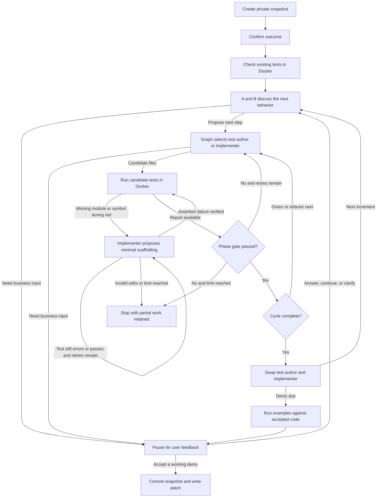

# Outcome-led XP pair runtime

## Start a session

From the agent checkout, pass the project directory and a desired outcome. The pair also accepts an empty project directory for a new Python module. If you omit `--goal`, the terminal prompts for it. If you omit the path, the current directory is used.

```sh
uv run --frozen xp-agent pair /path/to/project --goal 'Describe one behavior and an example'
```

For a Git project, start from a clean tracked baseline. The session copies safe tracked text files and omits untracked files. A non-Git project is scanned directly. Existing tests must pass at baseline. An empty project starts without baseline tests. The image must contain the target project's dependencies before the run. [Security boundaries](security.md)

Session creation writes the private snapshot before the first prompt. Type `confirm` to authorize model calls and Docker tests for the displayed outcome, `reject` to end the session, or enter a clarification to revise the displayed outcome. On a business question, answer it or use `continue` to ask the pair to proceed with the current agreement. On a working demo, type `accept` to finish, `continue` for another increment, or explain what should change.

## Production graph routing



| Step | What the controller accepts |
| --- | --- |
| Discuss | The partners share their interpretation and the next small step. A structured business question pauses the graph at that point. |
| Red | Append assertion-based tests. A new test fails by assertion and every prior required test still passes. |
| Bootstrap | If red fails due to a missing module or symbol, the implementer can supply minimal source scaffolding that preserves existing source statements and test content. Docker must then report a real assertion failure. When a scaffold runs but fails the gate, the same partner receives the pytest result and can retry within the limits. |
| Green | The other partner changes source. The runner must pass the new test and prior tests without errors or skips. |
| Refactor | The implementer may clean up source or explain why cleanup is unnecessary. The tests must still pass. |
| Demo | The controller executes proposed examples in Docker. The terminal shows observed and expected values, then waits for your response. |

A writes red and B handles green and refactor on cycle one. They switch on the next cycle and keep alternating. Discussion requests are sequential. Each request includes the assigned role, prior visible messages from both partners, the business agreement, project files, and execution feedback when available. Provider processes are fresh. The conversation continues through explicit replay from the checkpoint, which stores visible messages. [Code walkthrough](how-it-works.md)

## Settings and limits

| Option | Default | What it controls |
| --- | --- | --- |
| `--provider`, `--model`, `--auth` | Codex, `gpt-6-luna`, `cli` | Both partners use this configuration. Claude Code defaults to `haiku` when selected without a model. |
| `--budget` | 900 seconds | Active model and test execution time. Waiting at a prompt is excluded. Model calls are capped at 180 seconds and test invocations at 60 seconds or the time remaining, whichever is lower. |
| `--attempts` | 2 | Attempt limit for a coding phase and for scaffold candidates whose test reports fail the bootstrap gate. Provider, infrastructure, and structural scaffold errors can stop the run immediately. |
| `--max-cycles` | 12 | Maximum TDD cycles before the pair stops or presents its final increment. |
| `--demo-every` | 2 cycles | Default demo cadence. A partner can request an earlier demo. The graph also checks for feedback after 300 active seconds at a phase boundary. |
| `--output` | New directory under the state root | Use a fresh path to choose where the session and artifacts are stored. |
| `--trace` | Off | Record metadata and attempt export to local Langfuse for this invocation. |

Project snapshots are capped at 400 KB. Partner requests are capped at 480,000 bytes including history and stop when that limit is reached. During a time-based check-in mid-cycle, the terminal can report partial progress and ask for feedback. Acceptance requires a working demo. Clarifications can revise the agreed behavior, while accepted tests remain protected by the edit gates. [Provider options](providers.md) · [Tracing setup](tracing.md)

## Review the result or resume

The terminal prints the session directory. By default it lives under `${XDG_STATE_HOME:-$HOME/.local/state}/xp-coding-agent/pairs/`.

| Artifact | Contents |
| --- | --- |
| `workspace/` | Private Git repository with the accepted snapshot. Work is committed there on acceptance. |
| `changes.patch` | Diff from the snapshot baseline, written on acceptance for manual review and integration. |
| `result.md` and `pair-result.json` | Result, phase, cycle, remaining budget, workspace path, and evidence grade. |
| `pair-manifest.json` and `checkpoints.sqlite` | Startup settings and durable LangGraph state used for continuation. |
| `pair-state.json`, `pair-evidence.json`, and `pair-contract-grade.json` | Private state, versioned accepted transitions and snapshots, and their offline grade. |

Resume from a waiting prompt using the printed directory. Use `--trace` again if you want traces for the resumed invocation.

```sh
uv run --frozen xp-agent pair --resume /path/to/pair-session
```

SQLite restores the pending question or demo, conversation, provider settings, and remaining budgets. The CLI binds each reply to the interrupt it displayed. Reopening a terminal `blocked` session returns the recorded result. Start a fresh session after resolving the failure if you need to try the goal again. An interruption during a hosted request can repeat that request on recovery, so business prompts are the tested resume boundary. [Recorded validation](evaluation.md)

On failure, review the terminal reason and the private `pair-state.json`. A scaffold error means the pending test either errored, passed too early, skipped, or failed to preserve the required tests. Recent versions include counts and retain pytest feedback. A Docker error about a missing bind source can mean the session directory is outside the paths shared with the Docker VM. Use `--output` with a fresh path in a shared directory. [Cloud setup](../environment/README.md) · [Provider troubleshooting](providers.md#diagnose-or-qualify-a-provider)
