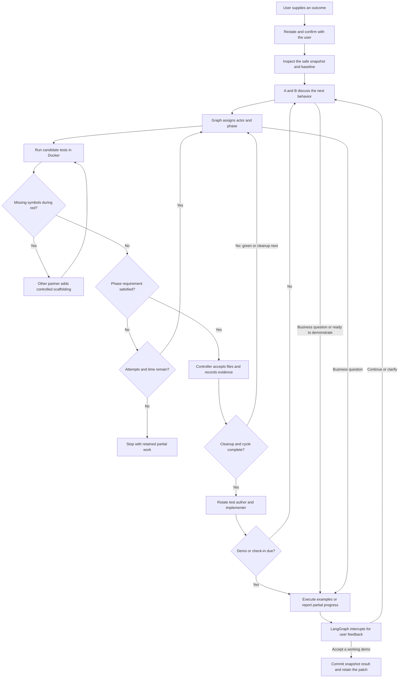

# Outcome-led XP pair runtime

This branch implements the initial bounded replacement described in the [redesign plan](xp-ping-pong-redesign-plan.md). Pairing is the default; the legacy interactive/batch interfaces remain explicitly available. Scripted production integration is verified; live-provider qualification is separately limited below.

## Production graph routing

`xp_agent/pairing/graph.py` owns the phase transitions and actor selection. Agent A authors the first test, B implements it; after green/cleanup, B authors the next test and A implements. Candidate tests run in a separate graph node. Neither partner chooses who acts next. Business feedback uses an actual LangGraph interrupt.



Provider failures, invalid infrastructure, failed scaffolding and exhausted resource limits can stop execution directly. These exception paths preserve the accepted snapshot; they do not produce a verified result. Discussion and code-generation requests are serialized, and retries stay with the assigned actor.

The same `build_graph` function is used by the runtime and the conformance adapter. `ProbeOperations` replaces partner/runner operations with instrumented doubles, not a separate passing reference graph. The production routing passes the existing compiled-graph probe for normal role reversal, premature-green rejection, failed-green rejection, business interrupt and resume.

The probe runner originally reused a test identity across cycles. Production red validation correctly rejected that as a regression. Its controlled reports now preserve prior passing identities and introduce a distinct failing identity per cycle.

The routing probe alone does not demonstrate model coding or a correct Money result. The production integration below adds workspace, conversation and independent result evidence. SQLite checkpoint support is installed for durable local sessions.

## Partners, code and durable business boundaries

Two `Partner` objects have fixed A/B identities. Each request includes that partner's continuing conversation from graph state, the current source snapshot, the agreement revision and actual execution feedback. Provider processes may be fresh, but the application replays accumulated conversation instead of resetting the partner's history. Finite context limits stop explicitly rather than silently truncate.

`Operations` mediates all edits. Tests are append-only during red; green and cleanup cannot change accepted tests. A controlled bootstrap path handles missing modules/symbols: source scaffolding must preserve existing source and leave an actual assertion failure before green can begin. Project code and demonstrations execute only in Docker.

`Session` uses SQLite LangGraph checkpoints and a session writer lock. Business interrupts can be resumed through new database connections. The original project is captured into a private snapshot repository; accepted output is committed there for manual integration. This initial pair flow uses snapshots, not linked worktrees, and never writes the original project.

The scripted Money integration builds multiplication, reusable values and exact USD/CHF addition from an empty project through the production graph. It observes A-red/B-green, B-red/A-green, then A-red/B-green, executes real demonstrations, and passes all 33 independent Money acceptance checks. Scripted partners supply known proposals; this verifies runtime wiring, not live model coding quality. Business-boundary reopening and evaluator binding are covered below; arbitrary crash-window recovery remains unqualified.

## Interactive product and evaluator wiring

The default `xp-agent`/`xp-coding-agent` entry point now starts the pair interface. Explicit `pair` is equivalent; `repl`, `plan` and `run` retain legacy behavior. Confirm the desired outcome, correct it if necessary, and respond to working demos with `accept`, `continue` or clarification. There is no upfront implementation-plan gate. No partner request or project test executes before confirmation.

Start a goal:

```sh
xp-agent pair /path/to/project --goal 'Desired behavior'
```

Resume a printed session path:

```sh
xp-agent pair --resume /path/to/private-session
```

The user-facing Money evaluation runs the **same production graph**:

```sh
umask 022
uv run --frozen --extra tracing xp-agent eval --pair --output eval-results/pair.json
# Real hosted coding requires authorized provider access; this is not an LLM judge:
uv run --frozen --extra tracing xp-agent eval --pair --live --output eval-results/pair-live.json
```

The deterministic run uses two scripted partner objects, actual graph routing, SQLite checkpoints, workspace writes, Docker test gates and executed demos. It then independently grades the actual accepted-transition records and runs all 33 Money acceptance checks. It also executes the production graph conformance probe for normal handoff and rejected red/green gates. Reports distinguish these dimensions from live model coding.

Evidence schema version 2 models bootstrap explicitly. Its source changes preserve existing source AST statements and accepted tests; an independently run pending test must still fail by assertion. Bootstrap does not advance the TDD phase. The original test author's history honestly precedes scaffolding; later turns receive its recorded outcome. Empty initial snapshots are allowed without pretending that zero tests passed. Schema version 1 remains supported unchanged.

A business response is bound to the displayed interrupt token, preventing a stale terminal from approving a different pending question/demo. Session reopening tests use fresh partner objects and verify conversation delivery, role preservation, remaining budgets and an unchanged final patch on repeated reads.

## Demonstrations, tracing and resource limits

Demos run examples in Docker against the accepted source revision. The business user sees labels, observed primitive results and expected results. Model prose is not substituted for execution. Failed examples block the demo. Clarifications are recorded in both continuing histories and agreement revisions; they do not replenish budgets or authorize test weakening.

A demo is requested after two completed cycles by default, when a partner believes the goal is ready, or at a bounded active-time check-in. A partial cycle is reported as partial progress, not a working increment. The initial test policy remains deliberately strict: tests can be appended, not weakened or rewritten. Contradictory business revisions that require changing accepted tests may need a new session; guarded test/interface evolution is still future work.

`--trace` enables the existing local Langfuse exporter. Pair generation/test observations use the safe actor and pair-mode metadata fields; full conversations, source and business text remain in private local session files. Ordinary export failures warn without falsifying code results. Pair eval traces include deterministic ownership/handoff/independent-acceptance scores, with fresh readback tested separately from coding checks.

The budget counts model and execution time, not user waiting. Context is bounded and replayed explicitly; hidden provider reasoning is not preserved or claimed. A process killed inside an external model call can repeat that request on recovery and consume quota. Tested restart behavior covers business boundaries, not every possible crash window. The controller rejects unexplained workspace changes and serializes session advancement with a writer lock.

## Current limits and provider transport

This is a bounded trusted Python/pytest prototype: safe text snapshots up to 400 KB, prepared dependencies, one approved project and one writer. It does not provision dependencies, launch arbitrary host commands, automatically merge/deploy, support general service projects, or prove hostile-code safety. Pair delivery currently uses independent snapshot repositories even for Git projects.

Both partners use the selected provider/model/auth mode, pinned in the session manifest; no fallback occurs. Saved credentials stay with the provider CLI. The transport preserves system proxy/CA settings, while continuing to exclude unapproved provider base-URL overrides and unrelated API keys. TLS verification and model tool restrictions remain enabled.

During this environment's qualification, the Codex CLI reported a saved ChatGPT login, but its synthetic request did not complete and an unauthenticated connection to `chatgpt.com` was explicitly denied by the cloud proxy. A narrow domain addition was saved in the environment draft; saving does not apply the running network policy. Live Money qualification remains blocked until provider access is usable. No successful live coding result is inferred from the scripted integration.
