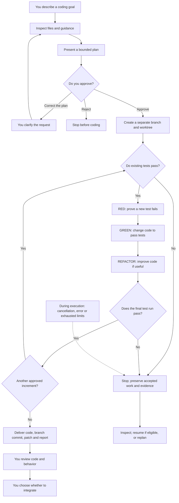
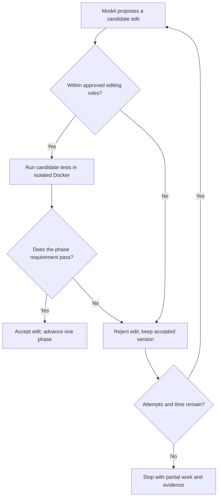

# XP Coding Agent: from your request to reviewable code

**Branch update:** the default interface now uses the [two-partner runtime](pair-runtime.md). The single-agent workflow explained below remains available explicitly as `xp-agent repl`, `plan` and `run`; its implementation details are retained for reference.


This guide explains the product experience: what you ask for, how the agent writes code, which choices you control, and what it delivers. No Python or agent-framework knowledge is assumed. It describes the implemented prototype; planned capabilities are marked separately.

XP stands for **Extreme Programming**, the development approach that inspires its small changes and test-first workflow. You give the agent a focused coding goal, review its plan, and approve it. It then attempts the agreed changes, checks them with real tests, and returns code for you to review.

## Contents

- [What this product is useful for](#what-this-product-is-useful-for)
- [The complete journey](#the-complete-journey)
- [How it actually writes code](#how-it-actually-writes-code)
- [An example from request to result](#an-example-from-request-to-result)
- [Your ways to use it](#your-ways-to-use-it)
- [The choices you control](#the-choices-you-control)
- [What you receive and what happens next](#what-you-receive-and-what-happens-next)
- [When things do not go to plan](#when-things-do-not-go-to-plan)
- [What tracing and tests tell you](#what-tracing-and-tests-tell-you)
- [Current boundaries](#current-boundaries)

## What this product is useful for

Use it for a small, clearly described change to an existing Python project that already has tests. Examples include correcting a calculation, handling an edge case, or changing how a function normalizes input. A useful request names the behavior you want, gives examples, and says what must keep working.

The product combines three roles:

| Who | Job |
|---|---|
| You | Set the goal, judge the plan, approve the scope, and accept the finished behavior. |
| The chosen AI model | Select relevant context and propose tests and code changes. |
| The agent's controller | Enforce the approved scope, apply accepted changes, run tests, and decide whether each step passes. |

This division matters because a model can suggest plausible code and still be wrong. The controller requires test evidence before moving on. You still decide whether the result solves the right problem.

The agent runs as an interactive terminal application. Its code-writing intelligence comes from your selected hosted provider, Codex or Claude Code. Running the agent locally means the program and test execution are local; selected project context still goes to the hosted model.

## The complete journey

The main diagram follows an interactive session on a Git project. Each coding phase includes the proposal/check/retry loop explained immediately below it.



**Approval is the handoff to execution.** Planning can call the model and disclose selected context, but rejecting the plan creates no coding workspace and runs no project tests. Once you approve, routine coding phases proceed without another approval prompt between them. A material change to the goal or provider requires a new plan.

The plan can contain one to five small, sequential behavior increments. Each goes through the same cycle; the agent does not approve its own expansion into unrelated work.

Within RED, GREEN and REFACTOR, a proposal only advances the workflow if its checks pass:



This loop handles rejected edits and failed phase checks. Provider/authentication errors, malformed responses, explicit model blockers and cancellation can stop execution directly; the agent does not promise to repair every kind of failure automatically.

## How it actually writes code

The agent first builds a bounded view of your project. It reads eligible files and project instructions, and asks the model which additional files matter. You can give a starting hint, but the interactive interface does not require you to list every source and test file yourself.

The plan distinguishes files needed to run the tests, context sent to the model, and files the agent may edit. These are different permissions: reading a file does not automatically grant permission to change it.

For each coding phase, the agent sends the approved task and relevant current file contents to the chosen model. The model returns proposed file contents and an explanation. The controller checks those edits and tests a candidate copy. It then writes accepted contents into the separate coding workspace. **The delivered result contains actual changed files and a Git diff; it is more than a suggested code snippet in chat.**

| Phase | What gets written | What the controller requires |
|---|---|---|
| Baseline | No new behavior yet. | Existing selected tests pass before starting. |
| RED | New or extended tests, while source behavior stays unchanged. | At least one new assertion fails because the behavior is missing; old tests still pass. Import errors, skipped tests, or a test that already passes do not qualify. |
| GREEN | Changes to approved source files. | Required old and newly accepted tests pass. Accepted tests cannot be rewritten to make the result look successful. |
| REFACTOR | Source improvements within the same scope, or an explained decision to leave it alone. | Tests still pass and accepted tests stay unchanged. |
| Final | A fresh verification run of accepted files. | Required tests pass again before the increment is marked verified. |

Tests run in a separate restricted Docker container, with no network access and a read-only test snapshot. The model does not choose arbitrary host commands or install missing dependencies during the task. Consequently, the required test environment must be prepared beforehand.

Each model request starts fresh with supplied context. Continuation relies on saved project/session records; it does not rely on a model remembering an earlier conversation.

## An example from request to result

Suppose an existing function is intended to double a number but currently returns the original number. A zero-input test passes, because both answers are zero.

You could ask:

> Make `double` return twice its input. Keep zero working, and support negative numbers and fractional numbers. Do not add dependencies.

The agent inspects the function and its tests, then proposes a plan describing the expected behavior, the files it needs, its permitted changes and its limits. You check that the plan reflects your meaning before typing `approve`.

The first coding step adds an assertion such as “doubling 2 produces 4.” Running it against the old implementation produces the required failure. The agent then proposes the source change that multiplies the input by two. It runs the old and new tests, considers whether the implementation needs cleanup, and runs final verification.

If the checks pass, you receive the changed function, the accepted tests, a reviewable branch and the execution report. Your own review should still check negative and fractional examples, the surrounding application, and anything the automated tests may have missed. The prose requirement alone does not create an independent acceptance test.

This example mirrors the project's synthetic evaluation fixture. Those evaluations also use a separate withheld check for additional inputs; ordinary user sessions do not automatically receive that extra check.

## Your ways to use it

### 1. Interactive terminal: the normal product experience

After installation and provider authentication, enter the target project's directory and launch:

```sh
xp-coding-agent
```

`xp-agent` is a shorter name for the same application. You describe your task at the `xp>` prompt, review the plan in the terminal, and type `approve` when satisfied. The terminal then shows progress such as BASELINE, RED, GREEN, REFACTOR and FINAL.

At plan review, type a correction to reject that plan and carry the correction into the next planning request. Type `reject` to discard the pending request. You then enter a revised goal when ready. `/new` clears the pending request and hints.

### 2. Batch commands: explicit planning and execution

Use this when you want scriptable commands or explicit control over selected files:

1. `xp-agent plan ...` creates a plan using your task and file lists.
2. You review its saved plan and approval identifier.
3. `xp-agent run ... --approve ...` executes that exact plan into a new output directory.

Batch runs use an independent snapshot repository, including for Git projects. They deliver changes for manual integration. Interactive session continuation with `/resume` does not apply to this batch workflow. See the [batch reference](batch-reference.md) for executable examples.

### 3. Evaluations: try the agent on disposable examples

Evaluations test the agent itself; they do not change your application.

| Choice | What it exercises | Hosted model request? |
|---|---|---|
| `xp-agent eval` | Scripted proposals through real controller/test execution on sample projects. Requires the prepared Docker environment. | No |
| `xp-agent eval --live ...` | The selected provider on a synthetic coding task, alongside scripted checks. | Yes; uses your authorized account and quota. |
| `xp-agent eval --experiment ...` | Scripted cases recorded as an experiment in local Langfuse. Requires its local service and project keys. | No |

## The choices you control

| Decision | Your options and their effect |
|---|---|
| Goal and acceptance | Describe the behavior and examples. Review the planned outcome before any coding execution. |
| Starting context | Let discovery select files, or use `/hint path/to/file` to suggest a starting point. Batch mode accepts explicit file lists. |
| Provider and model | Use Codex or Claude Code, with a model your account supports. Examples: `/provider codex gpt-6-luna cli` or `/provider claude haiku cli`. |
| Authentication | Use saved provider login, an explicit API key, or a Claude OAuth token where supported. Credentials are configured separately from task text. |
| Time and attempts | Startup `--budget` and `--attempts` options bound execution. Defaults are 600 seconds and two attempts per coding phase. The plan records its limits. |
| Tracing | `/trace on` or `/trace off`, or the startup `--trace` option, selects optional local Langfuse metadata tracing. |
| Cancellation and continuation | Ctrl-C cancels the current operation. `/resume` selects the latest session in the current shell; after restarting, use `/resume SESSION_PATH`. |
| Review and integration | You decide whether the delivered behavior is acceptable and whether to merge or otherwise integrate it. |

Provider/model/authentication and tracing preferences can be saved for future plans. An already approved session retains its approved provider and limits. There is no silent switch to another provider when quota runs out. See [provider configuration](providers.md) for model and authentication details.

`/help` lists shell commands; `/status` shows the selected provider and the latest session location. These are terminal commands, not a web application interface.

## What you receive and what happens next

For an interactive Git project, the agent starts from the approved commit in a separate linked working copy, called a **worktree**, on an `xp/...` branch. Your original checkout stays on its original branch. Successful interactive runs commit the approved result on the new branch. The agent does not automatically merge, push or deploy it.

For a non-Git project, it works in an independent snapshot repository. Batch mode uses that snapshot approach too. Review the resulting patch for manual integration rather than assuming it is a branch attached to your original repository.

The terminal prints where to find the session and its results. Start with:

| Item | What it helps you answer |
|---|---|
| `plan.md` | What did I approve? |
| `result.md` | What finished, what failed, and which checks ran? |
| `workspace/` and its diff | What code and tests actually changed? |
| `changes.patch` | What changes could I apply elsewhere after review? |

Additional session and evidence files support inspection and continuation. These records may contain project source and test output, so keep them private.

**Verified means the automated gates passed.** It does not mean you accepted the product behavior, all requirements were independently tested, or the result is ready to deploy. Review the diff, exercise your examples, and run your normal project checks before integrating.

## When things do not go to plan

| Situation | What happens and what you can do |
|---|---|
| The plan misunderstands the request. | Correct or reject it before approval; enter the clarified request to plan again. |
| Existing tests fail. | Execution stops at baseline. Resolve pre-existing failures or missing test dependencies before a new attempt. |
| A proposed test already passes, or a proposed implementation fails tests. | The candidate is rejected. The agent retries the same phase while its limits allow. |
| The provider is unavailable, credentials fail, or quota is exhausted. | The run stops. Fix access before attempting eligible continuation; choosing a different provider requires a new plan. |
| You cancel or execution stops partway through. | Last accepted work is retained. A partial result may include a deliberately failing RED test and is not a finished feature. |
| You want to resume. | The agent checks the saved agreement and working files before continuing. It preserves consumed attempts and remaining time. Changed or inconsistent work can make resume ineligible. |
| You change the requirement materially or exhaust the budget. | Create a new plan. Resume does not renew the budget or amend the old agreement. |

Handled stops normally retain reports and records. Abrupt termination, filesystem failures or setup failures can leave incomplete artifacts; automatic recovery from every crash is not promised.

## What tracing and tests tell you

Optional Langfuse tracing gives you a timeline of model requests, controller decisions and test execution, plus scores describing whether the recorded test-first sequence was followed. It records bounded metadata; source, prompts, task text and test output are excluded from exported traces.

Tracing is off by default and currently supports only a local Langfuse service. An ordinary trace-export failure warns without turning a successful coding result into a failed one. An explicitly requested Langfuse experiment does require its tracing service to work.

There are three different questions to keep separate:

- **Can the workflow and safeguards execute?** Scripted evaluations exercise this with controlled proposals and real tests.
- **Can traces be stored and read back?** Local Langfuse ingestion/readback checks exercise this integration.
- **Can a particular hosted model solve your task well?** That needs actual provider runs and your acceptance checks. Passing scripted tests and tracing checks alone cannot establish it.

See [recorded evaluation evidence](evaluation.md) and [tracing setup](tracing.md) for what has been checked and how to reproduce it.

## Current boundaries

The implemented product is a bounded prototype for trusted, small Python/pytest projects. It requires a prepared Docker test environment and a passing test baseline. Git projects need clean tracked files; untracked/ignored files are excluded from discovery and execution snapshots.

It can edit approved existing source files and add or extend tests. It is not currently a general project scaffolder or an environment-provisioning agent. Discovery is limited to 3,000 inventory paths, a 400 KB safe-text snapshot, and six selection rounds; binary assets and larger projects can fall outside its supported scope.

There is one coding partner today. Two-agent pairing, broader language support, general service setup, browser testing of target applications, rich amendments to approved plans, and an MCP integration are not delivered capabilities. Optional tracing experiments about future pairing rules do not add a second working agent.

For how the Python implementation realizes this experience, read [How it works](how-it-works.md). For future product direction, read the [roadmap](roadmap.md). For installation commands, use the [README](../README.md).
