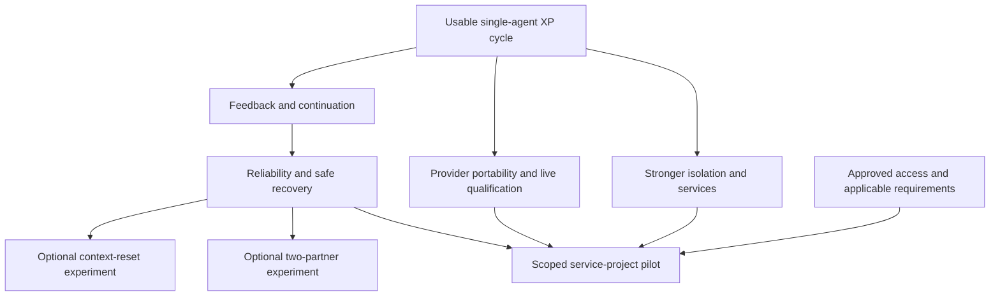

# Milestones and implementation handoff

This is the public, portable continuation plan. It preserves the agreed direction without requiring private machine-local notes. The [README](../README.md) describes current commands; [How it works](how-it-works.md) explains current implementation. Future graph-node names below are design sketches, not existing APIs.

## Goal and delivery rules

Improve coding outcomes through small, independently verified XP increments. Start with a useful single-agent tool, then evaluate whether context resets and two-partner programming improve correctness and review effort enough to justify their cost.

Every behavior change follows red–green–refactor. A human approves the bounded initial plan, scope, provider and budgets. Routine decisions and repairs proceed autonomously; business ambiguity, unsafe actions or scope expansion require human input. A roadmap is not authorization to implement all milestones. Deliver one usable vertical story at a time, with tests/evals, updated docs and reviewable results.

Plans and final reports remain separate. Preserve the original agreement; record explicit amendments when amendment support exists. Never reconstruct human approval from a model's narrative. Verification and human product acceptance remain distinct.

## Where we are

| Milestone | Status | Delivered / still needed |
|---|---|---|
| 1. Small complete XP cycle | Implemented prototype | Scoped discovery, approved plan, independent snapshot branch, baseline/red/green/refactor/final gates, budgets, Docker tests, reports and synthetic evals. Human acceptance is manual. |
| 2. Feedback and continuation | Selected-session continuation implemented | REPL, bounded discovery, linked worktrees and multi-increment execution exist. `/resume` reconciles files and preserves budgets. Material feedback amendments remain future work. |
| 3. Broader reliability and recovery | Partial foundations | Adversarial gates, cancellation and state records exist. Selected-session resume exists with application records; broader crash recovery, richer retry feedback, user acceptance checks and larger tasks remain. |
| 4. Backend portability | Adapters implemented early; qualification incomplete | Codex and Claude share a contract and factory. Codex has a prior live smoke pass; Claude has controlled transport/Docker coverage but no successful authenticated live cycle. Capability/policy checks remain. |
| 5. Fresh-context experiment | Not implemented | Current requests already start fresh per phase; there is no configurable continuous-vs-reset experiment or verified continuation handoff. |
| 6. Two-partner XP experiment | Not implemented | One coding partner today. No roles, handoff protocol or write leases. |
| 7. Stronger isolation and service support | Basic Docker boundary exists | Disposable services, controlled dependency preparation, stronger audit protection and broader execution profiles remain. |
| 8. Qualified service-project pilot | Not implemented | Requires a validated provider/account, applicable organizational controls, appropriate language/test support and normal team review. No production-readiness claim. |

Milestones 5 and 6 are optional experiments. They may be reordered, dropped or kept disabled if they do not help. Milestone 7 can move earlier when execution needs demand it. The second provider was brought forward to reduce dependence on one provider's quota; this does not make all of milestone 4 complete.

## Observability foundation

Optional local Langfuse metadata tracing and deterministic evidence scores are implemented; the [setup](tracing.md) documents current bounds. SDK experiments reuse the nine scripted controller/REPL cases and add four synthetic red/green pair-contract cases. This does not implement milestone 6. Real local ingestion/score retrieval, session links and the 13-case experiment UI have been verified with synthetic fixtures. The audit found and fixed SDK public-key scope metadata export. Next use a supported toy-project change and repeated/held-out scenarios to guide pairing/context experiments. Native UI evaluator infrastructure and LLM judges are not prerequisites.

## Interactive stories and remaining work

The desired user experience is to enter the target project directory, launch `xp-coding-agent`, describe the task conversationally, review/approve a plan in the terminal, and receive progress through XP increments. The REPL now performs bounded file selection and records in-shell approval; explicit lists/IDs remain only in the batch API. That is a prototype restriction, not a requirement we expect normal users to satisfy in a complex project.

Stories 1–3 are implemented under the current bounds; their descriptions preserve the intended acceptance direction. The next work starts with live-provider qualification and broader recovery/acceptance. Do not implement the entire backlog automatically:

1. **Interactive front end — delivered.** `xp-coding-agent` defaults to the current project and collects a goal, hints and provider preferences in a REPL. In-shell approval binds the exact displayed plan; batch commands remain for automation. Rich terminal editing/completion and semantic revision of an approved grant remain future work.
2. **Agent-led discovery — bounded implementation.** Controller-mediated model requests select relevant source/tests from tracked safe files. The runtime snapshot includes broader textual dependencies/configuration. Current bounds are 400KB, 3000 inventory paths and six rounds; larger repositories, binary fixtures and automatic dependency provisioning require additional work.
3. **Linked worktree execution — delivered.** Git projects use a branch at the approved commit with a clean tracked baseline. Untracked files are excluded; the agent never stashes/resets human work. Non-Git and batch runs retain independent snapshots. Tests run in Docker, and integration/publication remain manual. Resume reconciles files, Git branch/revision and changes outside the grant; stronger crash recovery is future work.
4. **Qualify Claude's actual authentication route.** Configure saved login or explicitly supplied key/token locally. Run the synthetic plan/run path and live eval with Haiku or Sonnet; verify structured output, forbidden-tool handling and cancellation. Record the tested client/auth/model without publishing credentials. Contract tests alone do not establish live support.
5. **Improve repair feedback and selected-run continuation.** Supply bounded, sanitized failure details without confusing rejected and accepted code. Define safe resumption, plan amendments, reconciliation and persistent remaining budgets. Start with one end-to-end resumable case.
6. **Executable acceptance and broader increments.** Bind human-supplied/approved acceptance checks to the plan. Then support several small XP increments under one approved goal, with final regression/acceptance verification and exception-only human interruption.

Keep the interactive shell and trusted controller outside the project execution sandbox initially: they need user input and provider authentication. Run generated/project code in isolation. Moving the UI into a container is not itself a safety improvement; exposing model credentials to project code would weaken the boundary.

A future MCP server can expose the same session service through bounded operations such as start, status, plan review/approval and cancel. The REPL and MCP should be alternative front ends to the same controller, not separate workflow implementations. Specify how human approval and provider disclosure remain authenticated when another agent invokes it; an agent's tool call must not silently authorize a new provider or broader scope. Long-running sessions need status/polling and cancellation rather than one opaque blocking call. This integration is deferred until the interactive/session API is stable.

REPL, bounded model-directed discovery, linked worktrees, multi-increment execution and selected-session continuation are implemented. Broader project support, material amendments and MCP remain future work. Worktree semantics follow [Git's documentation](https://git-scm.com/docs/git-worktree); the MCP idea follows the [protocol architecture](https://modelcontextprotocol.io/docs/learn/architecture). Neither mechanism supplies the project's execution sandbox.

## Milestone 1: keep the usable baseline

One focused Python behavior per XP increment; selected files only; passing baseline required; no arbitrary shell/dependency operations. Interactive discovery initially supplies safe README/AGENTS/CONTRIBUTING files from its tracked inventory, then model-requested paths. Batch discovery reads ancestor guidance plus explicit `--read` paths. It does not recursively follow all documentation links.

Interactive Git sessions use linked worktrees and require clean tracked source. Non-Git and explicit batch sessions retain independent snapshots; the batch API can snapshot selected uncommitted source without copying history. Limits count total attempts, including the first. Human acceptance and integration are manual.

Acceptance: the CLI generates a reviewable plan and runs a synthetic story through real XP gates, preserves original files, records partial work on handled failure/cancellation, and delivers branch/patch/evidence. Existing evals exercise invalid red, test weakening, scope escape, ambiguity and refactoring regression. Keep this baseline working in every later milestone.

## Milestone 2: incorporate feedback and continue selected work

Selected-session continuation is delivered. The following stories extend it to semantic feedback and amended plans; they are not current capabilities:

1. Load a specifically selected run and reconcile code, original plan and evidence. Reject missing/ambiguous records instead of guessing.
2. Classify supplied feedback as within-scope clarification or material amendment. Record any new human approval before affected work begins.
3. Run the next small behavior through XP gates and preserve earlier reports/evidence. Unrelated runs stay untouched.

Possible flow: `load_run → reconcile → classify_feedback → review_amendment_if_needed → next_increment → XP gates`.

Acceptance: a completed or blocked task can be revised intentionally; stale state is detected; old accepted work and evidence are preserved; only unresolved questions stop progress.

## Milestone 3: broader correctness and safe recovery

- Expand synthetic tasks and meaningful acceptance/regression coverage across multiple selected files. Keep one serial behavior increment; multi-file scope does not imply parallel writers.
- Introduce durable recovery only with explicit side-effect/replay semantics. LangGraph `interrupt()` and a local checkpointer are candidates, not a mechanical replacement for `status='blocked'`. A resumed node can restart: isolate human decisions from code-writing/model-call side effects and test each crash boundary.
- Preserve initial source needed to prove red, current accepted files, failed-attempt history, remaining budgets and approval identity. Reconcile files before choosing a recovery phase; never replay blindly or discard human edits.
- Improve retry feedback, executable acceptance, structured observations and test-refactoring debt. Frozen tests remain a deliberate restriction until safe test refactoring is designed.

Acceptance: recovery never skips XP gates; wrong implementations fail independent acceptance; budgets cannot reset through restart; stale or changed files cannot silently inherit old verification. State JSON alone is not proof of resumability.

## Milestone 4: prove portability

The common `ProposalBackend` contract and Codex/Claude adapters are implemented. Finish validation rather than redesigning the graph for another provider:

- Exercise actual authorized authentication paths and representative synthetic tasks through each adapter.
- Validate required capabilities and per-project provider policy before disclosure. Expose only supported configuration; refuse unsupported restrictions or credentials without a fallback.
- Verify cancellation and malformed output handling. Add usage/cost records when available, without promising exact spend enforcement unsupported by the CLI.
- Keep provider selection explicit and bound to approval. A future mid-run provider switch requires a reviewed disclosure/scope amendment and fresh provider session.

Acceptance: both providers pass shared contract and live behavior checks, produce comparable evidence, and fail safely when unavailable. Enterprise account qualification is a separate obligation.

## Milestone 5: evaluate context reset

At a verified boundary, create a compact handoff containing task, acceptance, code hash, decisions, tests, remaining work and failed approaches. Validate it against current files before continuing in a fresh context. Do not trust a handoff to grant permissions.

Compare continuous context against reset-at-boundary on repeated held-out tasks with comparable total budgets. Current fresh-per-phase calls are a baseline design, not evidence that resets improve outcomes.

Acceptance: permissions/counters survive resets, poisoned or stale handoffs fail safely, and results measure correctness, review corrections, time and usage. Keep the feature optional if it adds overhead without benefit.

## Milestone 6: evaluate two-partner XP

Add separate test-author and implementation contexts. Keep the controller as the only writer, with explicit role/write ownership when a second partner is introduced. Verify red before handing implementation to the other partner; verify green before refactoring and swapping roles.

Use bounded disagreement resolution and code-hash-bound handoffs. Incorrect tests need an explicit return-to-red process; partners cannot authorize their own scope expansion. Do not add speculative lease infrastructure to single-agent operation merely because it may be useful later.

Acceptance: stale handoffs and competing writes are rejected; pair runs preserve all XP evidence; measured quality/review effort is compared against a single-agent baseline under comparable budgets. Agreement between two models is not proof of correctness.

## Milestone 7: service execution and stronger isolation

Define concrete filesystem, network, credential, resource and cleanup policies. Prepare reviewed dependencies separately from generated-code execution. Add one disposable service with synthetic data, readiness checks and teardown on success, failure and cancellation. Expand languages/test runners one at a time.

Harden records, retention and secret handling; test hostile instructions, path escapes, egress and runaway processes. A branch is not a sandbox; a tools-disabled CLI is not an OS isolation boundary.

Acceptance: denied access and cleanup are demonstrated, baseline/integration tests are reproducible, and unavailable controls stop execution. Never substitute unrestricted host execution to make a test pass.

## Milestone 8: scoped qualification and pilot

Map actual organizational requirements to tested controls: approved provider/client/account, disclosure, retention, telemetry, credentials, isolation and review. Resolve gaps before sharing restricted code. Adapt the environment to the selected project's language and test runner; the current product supports only Python/pytest.

Deliver one low-risk change with synthetic test data through ordinary team CI/review. Migrations, deployment and external side effects require separate scope. Qualification applies only to the validated configuration and use case, not every repository.

These arrows indicate capability dependencies, not concurrent implementation or blanket authorization. Pairing and context resets are not prerequisites for a useful service-project pilot.

## Interactive implementation update

The primary user interface is now the REPL. Current bounds are small Python/pytest projects, tracked-only clean Git baselines, a 400KB safe textual runtime snapshot and six discovery rounds. Git filters are refused. Resume preserves phase attempts/time and checks accepted files; it is custom application persistence rather than a LangGraph checkpointer. Qualify larger repositories and authenticated live Claude next. Test/eval changes should exercise the REPL, including approval and original-checkout preservation, alongside lower-level adversarial gates.
