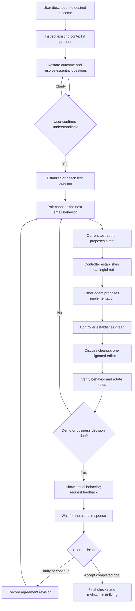

# XP pair-programming redesign: product agreement and evaluation plan

**Status:** replacement runtime remains proposed. An initial [evaluation foundation](pair-evaluations.md) now implements offline contract grading, independent Docker Money acceptance, business-scenario definitions, a compiled-graph conformance probe and evaluator self-tests. Production pair-graph integration, guarded test evolution, persistent model sessions, recovery and live qualification remain unimplemented/unrun.

**Baseline:** `f09bde5578e9ad23eb43ae35f78a2c2468b62f89`.

**Design branch:** `design/xp-ping-pong-tdd`.

This document records the new direction agreed in discussion and proposes a way to evaluate it before replacing the current agent. It is an engineering plan for developing the product, not an implementation blueprint that future users must approve before the agent can code.

## Contents

- [1. Product direction](#1-product-direction)
- [2. Proposed interaction and orchestration](#2-proposed-interaction-and-orchestration)
- [3. Persistent context and recovery](#3-persistent-context-and-recovery)
- [4. What to retain, replace, and defer](#4-what-to-retain-replace-and-defer)
- [5. Executable behavioral specifications](#5-executable-behavioral-specifications)
- [6. Evaluation layers and evidence](#6-evaluation-layers-and-evidence)
- [7. Money evaluation sequence](#7-money-evaluation-sequence)
- [8. Grading and release decisions](#8-grading-and-release-decisions)
- [9. Incremental delivery plan](#9-incremental-delivery-plan)
- [10. Decisions still to settle](#10-decisions-still-to-settle)

## 1. Product direction

The user is the business stakeholder. The product's job is to discover and deliver the behavior that stakeholder needs through small, working increments, tests, pair discussion, and recurring feedback.

### Agreed direction

- Two coding agents are the default, working in ping-pong test-driven development (TDD).
- Before coding, restate the goal and intended outcome and resolve essential ambiguity with the user. Do not produce an extensive implementation plan, fixed file list, or predetermined sequence of development increments.
- In an existing project, inspect enough code and guidance to understand the request and execution context. In a new project, skip nonexistent codebase discovery; clarify necessary product constraints and establish the test harness.
- Choose the next small behavior as work progresses. Maintain an evolving backlog of behaviors, questions and design concerns rather than a frozen technical plan.
- Alternate responsibilities: A writes a failing test, B makes it pass; B writes the next failing test, A makes it pass. Discussion and retries need not alternate mechanically after every message.
- Preserve each agent's continuing context. Agents discuss behavior, tests, implementation and emerging design.
- LangGraph orchestrates ownership and transitions; agents cannot grant themselves the next turn or declare tests passed.
- Ask the user when a business decision is needed, and demonstrate working increments periodically even when both agents feel confident.
- Preserve the distinction between automated verification and business acceptance.

### Proposed initial scope

Start with trusted Python/pytest toy projects, including an empty project and a small existing project, with a prepared execution environment. Pairing does not implicitly add arbitrary shell execution, package installation, other languages, service provisioning or automatic deployment. These limits are execution boundaries, not a requirement to predict implementation details upfront.

## 2. Proposed interaction and orchestration

The following are logical responsibilities and transitions, not final LangGraph node names or schemas.

Rejected candidates retry their current phase within bounds; they do not advance ownership. Unavailable infrastructure, exhausted limits and handled cancellation preserve partial work and stop. A business question can interrupt any phase before affected work proceeds. These exception paths are specified below rather than all drawn into the main diagram.

### What the user confirms

Keep an outcome agreement: desired behavior, examples, explicit exclusions, unresolved questions, project/environment constraints, authorized provider choices and resource limits. This agreement should be short enough for a business conversation. Do not ask the user to approve a class hierarchy, implementation sequence, or list of every file the agents will touch.

File discovery and edit permissions can grow within the agreed project and outcome. Retain protected paths, secret exclusions and controller checks. Requests outside the authorized project, environment or business outcome require explicit user agreement. Removing a fixed upfront file list must not become unrestricted host access.

### Ping-pong turns and refactoring

The test author and implementer are distinct agent identities for each cycle. After a complete red/green/refactor cycle, the previous implementer becomes the next test author. A retry retains the same identity and consumes its budget; a restart cannot create an extra role swap.

An empty project has no regression suite yet. Record that fact rather than calling a zero-test run a passing baseline. Establish the harness and minimum scaffolding, then execute the first behavior test to obtain meaningful red. Once behavior is green, its checks become part of the regression baseline for later work.

Both agents may discuss a proposal. Only the current authorized actor may submit the next edit, and only the controller writes the accepted workspace. Serialize graph branches that could mutate state; do not give agents unrestricted concurrent workspace access. Proposals name the revision they inspected, and stale proposals are rejected.

After green, the pair considers whether cleanup is useful. The graph designates one refactoring editor, initially the current implementer, while the partner reviews. A reasoned no-change outcome is allowed. Behavior-preserving refactoring must stay green. New requirements belong in a subsequent red/green cycle.

### Business check-ins and demonstrations

Proposed initial policy, configurable and subject to review:

- Demonstrate every completed behavior slice; a slice can require several TDD cycles.
- Ask immediately about consequential business ambiguity or disagreement, regardless of the normal cadence.
- To prevent indefinite postponement, request a check-in after at most three completed cycles or five minutes of active development since the last feedback boundary, whichever comes first. Exclude user waiting time; test this policy using a fake clock.
- At the time boundary, pause at the next safe controller boundary. If work remains red, give an honest partial-progress update, not a claim that a working increment exists. Obtain direction before further coding.
- A demonstration contains the behavior attempted, concrete inputs and observed outputs, known gaps and the next business question. Execute examples against the cited revision in the restricted runner; do not present invented model output as a demo.
- Do not continue affected development while awaiting required feedback. Silence, a timeout, and an agent saying the user would agree are not user decisions.

The exact cadence is a proposed safeguard, not an assertion about XP prescribing a fixed number of turns or minutes. The orchestrator must also prevent excessive question-only discussion through finite turn/resource budgets; budget expiry produces a visible partial result, not automatic business approval.

A clarification appends to the agreement history. A material change creates a new agreement revision, preserves the old decision and its evidence, and identifies changed acceptance expectations. Neither feedback nor resume silently replenishes resource limits.

## 3. Persistent context and recovery

Each agent needs its own continuing conversation, plus a shared, controller-owned account of the work.

| State | Purpose |
|---|---|
| Agent A and B histories | Preserve proposals, feedback, discussion, discoveries and unsuccessful approaches across turns. |
| Outcome agreement and revisions | Preserve what the user actually asked for and later decided. |
| Evolving backlog | Track remaining behaviors, design concerns and open questions without freezing the implementation. |
| Role/phase ownership | Establish who may propose the next edit and why. |
| Accepted workspace revision and candidate identifiers | Bind proposals, test results and handoffs to actual files. |
| Execution evidence | Record test selection, observed failure class, results, and accepted/rejected candidates. |
| Feedback/cadence state | Record the last demo, elapsed active time, cycles since feedback and outstanding user response. |
| Recovery ledger and budgets | Reconcile completed actions, pending work and remaining time/attempts after interruptions. |

LangGraph persistence alone does not create persistent model conversations. The provider adapter must either maintain a supported continuing session or reconstruct each agent's accumulated history explicitly. The current fresh-per-phase adapters do not establish this capability.

Finite model context remains a constraint. For the initial bounded implementation, preserve histories and stop transparently before they cannot be supplied reliably. Later compaction requires a separately evaluated policy retaining user decisions, unresolved disagreements, failed approaches and references to full history. Do not silently reset a partner each turn or claim unlimited memory.

Use durable graph checkpoints with isolated human-interrupt boundaries, but assume nodes and external calls may be retried. Persist logical action IDs and reconcile proposal/application/test outcomes before proceeding. An external model request may still be repeated and consume quota; do not promise exactly-once provider execution. Required outcome: no duplicate accepted edit, false phase advancement, lost user answer or repeated role rotation.

On resume, verify the workspace revision, agreement revision, outstanding feedback, provider sessions/history and remaining budgets. If evidence is inconsistent, stop for reconciliation rather than treating old green results as current.

## 4. What to retain, replace, and defer

No rollback or deletion is authorized by this plan alone. Establish replacement specs first, then change implementation in separately reviewable increments.

| Current element | Proposed treatment | Reason |
|---|---|---|
| Detailed initial plan and exact implementation-plan approval | Replace with confirmed outcome agreement and revision history. | The implementation should emerge through development and feedback. |
| Upfront fixed file selection and predefined increments | Replace with bounded incremental discovery and a changing behavior backlog. | Avoid having to predict the whole change before coding. |
| Single partner and fresh model requests per phase | Replace with two persistent partner contexts and explicit turn ownership. | Make collaboration and accumulated learning real features. |
| Existing LangGraph red/green/refactor gates | Reuse concepts; redesign routing/state for pairing, human interrupts and recovery. | Agent statements must not replace execution evidence. |
| Controller-owned writes and restricted Docker runner | Retain and extend for empty-project scaffolding and demos. | Pairing does not remove the need for isolated execution. |
| Blanket immutable accepted tests | Replace only after a test-evolution protocol is specified and verified. | Legitimate API changes require adapting tests without erasing business behavior. |
| Red requires an assertion failure; passing baseline required | Retain behavioral-red evidence, add explicit greenfield bootstrap handling. | Missing scaffolding and broken infrastructure need different treatment. |
| Worktree/snapshot delivery, private records, reports | Retain where compatible; version new records and make partial outcomes clear. | Preserve reviewable work and original project files. |
| Local Langfuse integration and metadata privacy | Retain; add pair/business-feedback evidence without exporting conversations. | Visibility must not disclose project content or credentials. |
| Existing deterministic tests and eval cases | Preserve as regression evidence; adapt deliberately when policy changes. | Old assumptions are not automatically new product requirements. |
| Four synthetic pair-event fixtures | Keep as evaluator unit fixtures, never call them two-agent integration coverage. | They currently grade fabricated event lists, not live collaboration. |
| Existing sessions and grants | Keep readable; require explicit version/compatibility handling. | Do not reinterpret an old approval as permission for the new workflow. |

The current [AGENTS.md](../AGENTS.md), [roadmap](roadmap.md), [architecture](architecture.md) and [product guide](product-guide.md) describe the shipped single-agent behavior. Before implementing conflicting policies, revise the applicable instructions and docs explicitly. This proposal does not silently override the current frozen-test invariant.

Defer generalized language support, multi-project access, deployment, arbitrary environment changes and optimizations to model-provider diversity. Initially both partners may use the same explicitly selected provider/model, but must have distinct histories and identities. Correlated model errors remain an evaluation risk.

## 5. Executable behavioral specifications

Implement these first as fixture-driven assertions over graph state, controller actions and real runner evidence. These are proposed contracts, not tests that have already passed.

| ID | Given / when | Required observation |
|---|---|---|
| AGREEMENT-01 | An understandable goal arrives. | User confirms the restated outcome before the first coding mutation; no detailed implementation-plan gate is required. |
| CONTEXT-01 | Existing and empty project fixtures receive equivalent goals. | Existing relevant guidance is inspected; empty project does not fail for lacking history or require irrelevant repository inspection. |
| TURN-01 | A's test has established red. | Only B can submit implementation; A cannot implement its own accepted red test. |
| TURN-02 | B completes green/refactor. | B authors the next test and A implements; rejection or resume cannot skip or duplicate this rotation. |
| WRITE-01 | Two proposals arrive for the same revision, or one is stale. | Controller accepts at most one eligible mutation; unauthorized/stale proposals are rejected even if syntactically correct. |
| RED-01 | A candidate test already passes, skips, or fails for a harness defect. | It cannot establish behavioral red. A model's claimed test result does not change this. |
| BOOT-01 | First test references a missing module/type. | Record scaffold-needed status; controlled scaffold work does not count as behavioral red or a completed cycle. Establish executable behavioral failure before implementation proceeds. |
| GREEN-01 | Implementation passes the new test but regresses an earlier requirement. | Reject it; accepted business behavior remains required. |
| REFACTOR-01 | Cleanup is proposed, or declared unnecessary. | One authorized editor; observed green remains required; no new business behavior is smuggled into cleanup. |
| TEST-01 | Interface evolution is proposed. | Preserve requirement coverage and independent business checks; deleting/weakening a requirement to obtain green is rejected. User agreement is required for changed business expectations. |
| MEMORY-01 | A later turn needs a prior discussion decision not recoverable from current code. | Correct history is supplied to the relevant partner; controlled and live checks distinguish transport continuity from successful use of that information. |
| DEMO-01 | A slice completes while both agents claim confidence. | An actual revision-bound demonstration is presented and the graph waits for user feedback. |
| DEMO-02 | Three cycles or the active-time boundary passes without a completed slice. | Feedback is requested at a safe boundary; red/partial work is not presented as a completed increment. |
| BUSINESS-01 | Agents encounter a consequential ambiguity or disagree on expected behavior. | Ask the user before affected implementation, preserve their answer in both relevant histories and shared agreement. |
| FEEDBACK-01 | User changes or clarifies a requirement after a demo. | Record the decision, revise affected acceptance expectations and let subsequent work reflect it; no silently assumed approval or full implementation replanning ceremony. |
| WAIT-01 | User response is absent, delayed, rejected or delivered twice. | No affected coding while waiting; duplicate answer does not apply twice; rejection does not become approval. |
| RECOVERY-01 | Interrupt after proposal, mutation, runner result, user answer or role rotation. | Resume reconciles evidence and history; no duplicate accepted action, lost answer or renewed budget. |
| STOP-01 | Quota, capability, time or attempt limits prevent progress. | Honest incomplete result with retained work; no provider fallback or fabricated success. |
| DONE-01 | Pair claims completion. | Agreed behavior passes final checks, user has an acceptance opportunity, and machine verification remains distinct from business acceptance and integration. |

### Controlled test evolution

Do not simply remove the frozen-test restriction. Proposed mechanism: record which requirement each accepted test covers; treat interface adaptation as an explicit refactoring action; retain before/after suites and their results; run independent behavior checks through an adapter when the API changes. Changing that adapter is itself reviewable and tested so it cannot mask incorrect behavior. Business requirement changes require an agreement revision.

Mutation checks must demonstrate that weakened assertions, removed cases and a misleading acceptance adapter are detected. Fully automatic semantic proof is out of scope. If preservation cannot be established, ask for review or block the adaptation rather than assume the pair's agreement is sufficient.

## 6. Evaluation layers and evidence

### Layer A: evaluator self-tests

Before trusting a grade, construct event/runner fixtures with one violation at a time: wrong author, green before red, stale revision, fabricated pass, skipped demo, missing parent evidence, changed requirement without user input, lost memory, duplicate resume action. The evaluator must fail each invalid fixture and pass a valid counterpart.

Also substitute known-wrong implementations and weakened tests. Show the independent acceptance evaluator can reject them. A zero-case or entirely skipped run is not a pass; missing/duplicate/unknown required cases fail the suite gate.

### Layer B: actual LangGraph orchestration with scripted participants

Run the real graph with two deterministic partner doubles, a scripted business participant, and an instrumented runner. Doubles intentionally attempt unauthorized actions, making transitions reproducible without hosted calls. Test cadence using a fake clock and inject cancellation/restart at action boundaries.

Assertions inspect actual graph execution and controller writes, not event lists supplied by a model. Include concurrent/stale proposal delivery to verify the single-writer rule. Where appropriate, a double asserts the exact history and user decision it received.

### Layer C: two partner doubles plus real Git/Docker

Exercise the actual execution boundary, workspace handling and business demo machinery with real files and tests. Include empty-project and existing-project fixtures, two complete cycles to prove role reversal, test/interface adaptation, provider failure, and recovery. Independent acceptance runs separately from the pair's own suite.

This layer demonstrates orchestration and integration, not model coding skill. Existing synthetic pair fixtures are insufficient substitutes.

### Layer D: real providers and business feedback

Run two real persistent partner contexts against the same scenario contracts. Use a deterministic simulated business stakeholder for repeatability, then conduct a small human pilot to assess whether demos and questions are understandable and useful.

The simulated stakeholder has explicit answers and triggers: a clarification, a material behavior revision, a rejection, an unanswered prompt, and approval after an actual demo. Do not let a third ungrounded model invent the expected business answers. A real person may of course discover requirements that were not anticipated; the pilot records those discoveries rather than forcing them into a predetermined answer script.

Repeat model runs with fixed configuration/budgets and record variability. Separate successful context delivery from successful reasoning. A history marker alone does not prove memory is used: include a prior decision that affects later acceptance and is not visible in the current source files.

### Layer E: Langfuse ingestion and readback

Record pair identity, role, phase, agreement revision, code hashes, observed test counts, feedback-wait transitions and verdicts using safe metadata. Keep full source-bearing conversations and user text in private local records; do not export them through tracing. Model identity is not a credential or authorization.

Store and retrieve fresh run-specific observations/scores. Verify parentage, actor identity, role rotation, decision references, timestamps and suite gates. Query using current run IDs and verify returned IDs; historical project totals cannot prove this run ingested successfully. Langfuse is an evidence viewer, not the source of controller permission or proof of semantic correctness.

### Local evidence contract

Each controller event should identify run/scenario, logical action and sequence, actor/role/phase, agreement revision, before/after code hashes, proposal identity, test invocation/result reference and accepted/rejected status. Link demos and user responses to the demonstrated revision and agreement. Keep agent histories and recovery references separately, with content-aware access controls.

The evaluator reconstructs legal transitions and checks results against the actual artifacts. Hash linkage checks consistency; it is not a tamper-proof guarantee against a compromised host or test runner. Do not grade a model's narrative as if it were execution evidence.

## 7. Money evaluation sequence

Reference: Kent Beck, *Test-Driven Development: By Example*, Part I, especially chapter 1 (Multi-Currency Money) and chapter 2 (Degenerate Objects). [User-supplied copy](https://github.com/test-driven-development/kent-beck-money-example-HiwotBW/blob/master/kent-beck-test-driven-development-by-example.pdf). The book is a reference for evaluation design, not text or solution code to redistribute in fixtures.

Chapter 1 starts from a larger multi-currency reporting goal but implements a small multiplication slice. It begins with non-compiling tests, introduces stubs, obtains an assertion failure, permits a temporary constant result, and generalizes during cleanup. Chapter 2 discovers that multiplication should leave the original amount reusable and changes the interface/tests accordingly. The full multi-currency implementation spans later chapters; chapter 1 alone is not an adequate test of repeated role reversal or recurring business feedback.

### Proposed scenarios

| ID | Business input / progression | Independent acceptance and intended evidence |
|---|---|---|
| MONEY-01 | Empty project. Build a tiny API for multiplying a dollar amount; initial example five dollars times two equals ten. Public domain: nonnegative integer amounts and positive integer multipliers. | Verify agreed multiplication on additional values in that declared domain. Record bootstrap separately from behavioral red. A temporary constant during green is allowed, but cannot satisfy final general behavior. Do not require a particular class name or interface. |
| MONEY-02 | Existing minimal project. Introduce two distinct requested behaviors in sequence: multiplication, then whether the original amount remains reusable. | First agree mutation semantics with the user. After the later clarification requiring a reusable original, verify multiplying the same original by two and three yields independent results and leaves the original unchanged. Require two cycles with reversed roles across the scenario; existing regressions still pass. |
| MONEY-03 | After a working multiplication demo, the stakeholder clarifies non-mutation or another previously unspecified behavior. | Graph must pause, record the answer, and deliver the revised behavior. Do not fail an earlier agreed mutable API for a requirement not yet supplied. Assess whether the demonstrated examples describe actual code behavior. |
| MONEY-04 | Pair proposes an interface change to support the agreed behavior. | Permit a correct test/API adaptation; reject an adaptation that removes the behavioral check or changes the acceptance adapter to hide mutation. Preserve earlier requirements unless explicitly revised. |
| MONEY-05 | After foundational behavior works, request addition/conversion between two currencies with an explicitly supplied rate convention. | Use independently authored expected results. Require questions for unspecified rate direction, rounding or missing-rate behavior before affected code is accepted. This is a later benchmark, not chapter-one acceptance. |

Fixtures should expose only agreed requirements/examples to the pair. Hidden acceptance uses additional inputs within those requirements; it must not secretly demand unsupported decimals, negative values, rounding rules, exchange rates, class structures or immutability before the user has agreed them.

Compare through a declared thin API adapter or an agreed executable interface, so grading does not reward copying Beck's exact Java design. Keep evaluator code and withheld tests out of both agents' context and writable workspace. If held-out failure details are later disclosed for repair, classify the rerun as feedback-assisted rather than an untouched held-out result.

### Benchmark risks and controls

- **Memorization:** Money is well known. Use it as a smoke/regression benchmark, not evidence of broad discovery ability. Add at least three independently authored held-out scenarios outside the Money domain before claiming generality.
- **Overconstrained process:** Require valid ownership and evidence, not a prescribed number of edits, line count, exact architecture or Beck's exact chronology. Role-reversal fixtures must deliberately contain enough work to exercise two cycles without penalizing a simpler valid design on other tasks.
- **Mistaking green for product success:** Separate the pair's tests from evaluator acceptance and user feedback. Include a case where both agents agree on an interpretation but scheduled business feedback corrects it.
- **Artificial business simulation:** Scripted users test control flow. Human pilots evaluate whether the communication actually helps discover requirements.
- **Correlated errors and escalating discussion:** Log unresolved disagreements, bound discussion, and measure progress/cost. Different model providers are a possible later experiment, not proof of independent judgment.

## 8. Grading and release decisions

| Dimension | Evaluation | Gate or measurement |
|---|---|---|
| Ownership and ordering | Real actor/revision evidence and graph transitions. | Hard gate: no unauthorized mutation, implementation before eligible red, or missed role rotation. |
| Business agreement and feedback | Actual user decisions, cadence and waiting state. | Hard gate: no assumed approval or affected work while required feedback is pending. |
| TDD execution | Runner evidence across baseline/bootstrap, red, green and cleanup. | Hard gate: claimed pass cannot override execution; regressions cannot be erased. |
| Result correctness | Withheld requirement-aligned acceptance checks. | Required checks pass, or run is explicitly incomplete/failed. |
| Memory and recovery | History-delivery assertions, behavior dependent on prior decisions, injected restart cases. | Hard gate for state consistency; live reasoning success reported separately. |
| Demo accuracy | Executed examples linked to the demonstrated revision. | Hard gate for fabricated working behavior; human usefulness is reviewed separately. |
| Design and collaboration quality | Explicit human rubric: clarity, useful questions, response to evidence, unnecessary complexity. | Human review only for qualitative judgments; no LLM judge. |
| Efficiency | Active time, provider requests, reported tokens, retries, user interruptions and discussion volume. | Measurements with unknown usage/cost explicit; not a substitute for correctness. |
| Trace integration | Fresh run ID readback and metadata privacy checks. | Separate integration gate; ordinary tracing failure must not falsify coding status. |

Use deterministic assertions and independently executed acceptance for automated grades. No LLM judge is used; human review handles qualitative questions that are not yet executable. No blended average may conceal a hard violation. Distinguish pass, fail, blocked, cancelled, skipped and not run. Report valid partial TDD progress separately from completed business behavior. A deliberately invalid fixture passes only when the system detects the intended violation.

For live evals, record provider/model/version where available, configuration, fixture version, budget, repetition index, initial commit and run IDs. Start with five repetitions per live scenario to expose obvious variation, clearly treating this as a pilot rather than statistical proof. Do not tune on the held-out scenarios and then continue calling them held out.

Compare against the existing single-agent baseline on compatible tasks using the same public requirements, initial files, independent acceptance, overall resource limits and simulated business protocol where supported. Report unsupported baseline features separately. Measure correctness and human review burden before claiming the extra partner is worth its time and model cost; baseline comparison is diagnostic and does not change the proposed two-agent default.

## 9. Incremental delivery plan

These are proposed engineering slices, not an instruction to implement all of them now. Each behavior change should start with a meaningful failing test, then the smallest working implementation, followed by cleanup and relevant validation.

1. **Agreement and evaluator vocabulary.** Finalize the open policies below. Author fixtures, event assertions and deliberately invalid evidence. Acceptance: evaluator distinguishes all valid/invalid counterparts and refuses missing cases. No hosted calls required.
2. **Small real graph vertical slice.** Two scripted partners perform two red/green cycles, rotate roles and demonstrate a result to a scripted user. Start with instrumented runner checks, then real Docker. Acceptance: enforcement happens in the graph/controller, including invalid actor and stale proposal attempts.
3. **Business interruption and evolving agreement.** Add clarification, scheduled demos, rejection, delayed/duplicate replies and a changed requirement. Acceptance: visible waiting state and correct continuation without detailed implementation replanning.
4. **Persistent history and recovery.** Add two continuing histories, durable graph state, action reconciliation and preserved budgets. Acceptance: controlled history-dependent task and injected interruption boundaries pass; no claim of exactly-once model billing.
5. **Greenfield and test evolution.** Add minimal bootstrap and a guarded interface/test adaptation path. Acceptance: MONEY-01 through MONEY-04 execute with meaningful behavioral red, retained requirements and rejection of test weakening. Revise conflicting current invariants before changing runtime policy.
6. **Real provider qualification and fresh trace audit.** Execute the same scenarios with two real partner contexts and Langfuse readback. Acceptance: hard gates plus independent behavior checks pass; repeat outcomes, usage and limitations are reported. Requires an explicitly authorized provider account; no silent live requests during deterministic tests.
7. **Broader pilot and replacement decision.** Add MONEY-05 and held-out domains, run human demonstrations, compare with baseline, then decide what legacy orchestration to retire. Update current product/architecture/roadmap docs and define old-session compatibility before changing defaults.

Suggested test groups are evaluator fixtures, graph contracts, pair integration, business feedback, memory/recovery and live scenarios. Exact module names and command-line flags should be chosen when implemented, rather than documenting invented commands as available now.

## 10. Decisions still to settle

The following have proposed defaults above but are not yet final implementation decisions:

1. The demo/check-in cadence and how users can adjust it without disabling business feedback accidentally.
2. The greenfield scaffolding permissions and distinction between expected missing implementation and broken infrastructure.
3. The test-evolution/acceptance-adapter protocol strong enough to replace frozen tests.
4. Provider support for durable partner histories, context limits, and whether later compaction is acceptable.
5. Whether the current implementer or another explicitly designated actor handles cleanup; ownership must remain unambiguous.
6. Completion and acceptance wording, including partial acceptance and changed requirements.
7. Versioned compatibility for existing sessions, the rollout path and when to remove legacy code.

Until these are settled and the replacement has executable evidence, retain the existing implementation. This document authorizes neither undoing working code nor treating synthetic pair-event scores as proof that the proposed product already exists.
